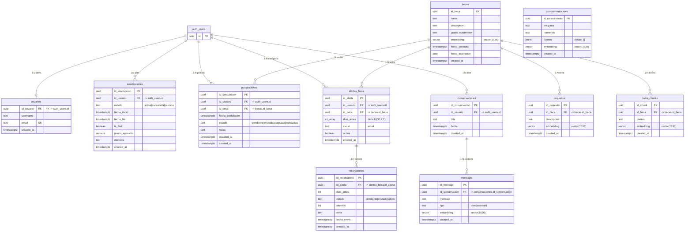

# Base de datos — BecaBot

Documentación del esquema de datos del proyecto **BecaBot-Rag** (InsForge: PostgreSQL + `pgvector`).
Describe cada tabla, el **por qué de cada campo**, el **por qué de cada relación**, y cómo encaja todo
(índices, funciones, triggers, RLS y flujos).

> Fuente de verdad: `migrations/20261013214445_becabot-schema.sql` y
> `migrations/20261014004841_web-knowledge.sql`. Si cambia el esquema, actualiza este documento.

---

## 1. Visión general

- **Motor:** PostgreSQL (proyecto InsForge) con extensión **`pgvector`** para búsqueda semántica y
  **`pgcrypto`** para `gen_random_uuid()`.
- **Esquemas:** `public` (dominio) y `auth` (identidad, provista por InsForge; no se migra aquí).
- **11 tablas propias** en `public`.
- **Zona horaria del producto:** `America/Mexico_City` (usada por `hoy_mx()`).
- **Embeddings:** `vector(1536)` (modelo `text-embedding-3-small`) en `becas`, `requisitos`,
  `beca_chunks`, `conocimiento_web` y `mensajes`.
- **Acceso:** cliente (`anon` / `authenticated`) vía RLS; backend/edge functions con **service role**
  (bypassa RLS).

Subsistemas:

| Subsistema | Tablas |
|---|---|
| RAG / conocimiento | `becas`, `requisitos`, `beca_chunks`, `conocimiento_web` |
| Identidad / perfil | `usuarios` |
| Premium / pagos | `suscripciones` |
| Postulaciones / alertas | `postulaciones`, `alertas_beca`, `recordatorios` |
| Chat | `conversaciones`, `mensajes` |

---

## 2. Diagrama ER

---

## 3. Convenciones

- **PK:** `uuid` con `DEFAULT gen_random_uuid()` (no autoincrementales: los IDs no deben ser
  adivinables ni dependientes de secuencia, y facilitan sincronización entre entornos).
- **Timestamps:** `TIMESTAMPTZ NOT NULL DEFAULT now()`; se guarda en UTC y se interpreta con
  `America/Mexico_City` cuando aplica (día).
- **FK:** siempre `ON DELETE CASCADE` (ver razones en §5).
- **Estados:** `TEXT` + `CHECK (...)` en vez de `ENUM` (más fácil de evolucionar sin `ALTER TYPE`).
- **Embeddings:** `vector(1536)` fijo; mezclar otro modelo de dimensión distinta rompería columnas y RPC.

---

## 4. Tablas, campos y por qué

### 4.1 `usuarios` — perfil de la app

**Propósito:** perfil público de la aplicación, separado de las credenciales. Su PK es el mismo `id`
de `auth.users`, así que la identidad vive en un solo lugar.

| Campo | Tipo | Restricciones | Por qué |
|---|---|---|---|
| `id_usuario` | uuid | PK, FK `auth.users(id)` ON DELETE CASCADE | Reutiliza la identidad de InsForge Auth como clave: evita un segundo identificador y credenciales duplicadas. El `CASCADE` borra el perfil si se elimina la cuenta de auth. |
| `username` | text | — | Nombre para mostrar. Nulo por defecto (el usuario puede no haberlo elegido); no es `UNIQUE` para no bloquear handles repetidos en el registro. |
| `email` | text | NOT NULL, UNIQUE | Copia local consultable del correo (para listados/joins sin tocar el esquema `auth`). `UNIQUE` impide dos perfiles con el mismo correo. |
| `created_at` | timestamptz | NOT NULL, DEFAULT `now()` | Auditoría: cuándo se creó el perfil. |

### 4.2 `becas` — entidad central del RAG

**Propósito:** una fila = una beca. Es la entidad que agrupa descripción, requisitos y fragmentos, y la
que se recupera primero en la búsqueda semántica.

| Campo | Tipo | Restricciones | Por qué |
|---|---|---|---|
| `id_beca` | uuid | PK, DEFAULT `gen_random_uuid()` | Identificador estable e independiente del `id` de fuentes externas; permite reinserciones controladas. |
| `name` | text | NOT NULL | Título de la beca. Obligatorio porque es la etiqueta principal que ve el usuario y la que aparece en las *fuentes* de la respuesta. |
| `description` | text | — | Cuerpo completo de la beca (markdown curado). Nulo porque una beca puede cargarse solo con requisitos. Además es el texto base de su embedding. |
| `grado_academico` | text | — | Nivel educativo (primaria, bachillerato, posgrado…). Permite filtrar en `match_contexto` (`filtro_grado`) para no devolver becas de otro nivel. Texto libre (no enum) porque los niveles son heterogéneos y cambian. |
| `embedding` | vector(1536) | — | Representación semántica de `name + description`; base de la similitud coseno. La dimensión (1536) la fija `text-embedding-3-small`. |
| `fecha_consulta` | timestamptz | — | Última vez que se consultó/actualizó la beca; mide la frescura de la información. Nulo porque no siempre se conoce. |
| `fecha_expiracion` | date | — | Vigencia de la convocatoria. Tipo `date` (no timestamp) porque la vigencia es a nivel día. Nulo = sin caducidad conocida. `match_contexto` excluye las vencidas. |
| `created_at` | timestamptz | NOT NULL, DEFAULT `now()` | Auditoría: cuándo se insertó. |

### 4.3 `requisitos` — requisitos normalizados (N por beca)

**Propósito:** separar los requisitos de una beca en filas propias, cada una con su embedding, para que
preguntas del tipo "¿qué piden?" recuperen el requisito exacto.

| Campo | Tipo | Restricciones | Por qué |
|---|---|---|---|
| `id_requisito` | uuid | PK, DEFAULT `gen_random_uuid()` | Identidad propia del requisito. |
| `id_beca` | uuid | NOT NULL, FK `becas` ON DELETE CASCADE | Pertenencia a la beca. El `CASCADE` evita requisitos huérfanos si se borra la beca. |
| `descripcion` | text | NOT NULL | Texto del requisito. Obligatorio porque un requisito vacío no aporta; se embebe individualmente para búsqueda granular. |
| `embedding` | vector(1536) | — | Similitud por requisito (recuperación fina, mejor que embeber toda la beca). |
| `created_at` | timestamptz | NOT NULL, DEFAULT `now()` | Auditoría. |

### 4.4 `beca_chunks` — fragmentos de descripciones largas

**Propósito:** subdividir descripciones largas (más de ~500 tokens) en fragmentos con embedding propio.
Solo se puebla cuando la descripción es grande.

| Campo | Tipo | Restricciones | Por qué |
|---|---|---|---|
| `id_chunk` | uuid | PK, DEFAULT `gen_random_uuid()` | Identidad del fragmento. |
| `id_beca` | uuid | NOT NULL, FK `becas` ON DELETE CASCADE | Pertenencia a la beca. |
| `content` | text | NOT NULL | El texto del fragmento. Obligatorio. |
| `embedding` | vector(1536) | — | Similitud por fragmento. |
| `created_at` | timestamptz | NOT NULL, DEFAULT `now()` | Auditoría. |

**Por qué existe el troceo:** los embeddings tienen límite de tokens y pierden detalle en textos largos;
trocear mejora la precisión de la recuperación sin saturar el contexto del LLM.

### 4.5 `conocimiento_web` — RAG autoalimentado

**Propósito:** guardar conocimiento útil obtenido de la web (resumido por un juez LLM) para reutilizarlo
en respuestas futuras. Es un almacén **independiente**, sin relación con una beca concreta.

| Campo | Tipo | Restricciones | Por qué |
|---|---|---|---|
| `id_conocimiento` | uuid | PK, DEFAULT `gen_random_uuid()` | Identidad del conocimiento. |
| `pregunta` | text | NOT NULL | Pregunta que originó el conocimiento. Se usa como parte del texto embebido y para trazabilidad. |
| `contenido` | text | NOT NULL | Resumen autocontenido (tema + resumen) que se inyecta al contexto del LLM. Obligatorio: sin contenido no hay conocimiento. |
| `fuentes` | jsonb | NOT NULL, DEFAULT `'[]'` | Lista de fuentes `[{title, url}]` para atribución. `JSONB` porque es una estructura variable que no necesita joins. |
| `embedding` | vector(1536) | — | Similitud para recuperar el conocimiento relevante. |
| `created_at` | timestamptz | NOT NULL, DEFAULT `now()` | Auditoría y antigüedad del conocimiento. |

### 4.6 `suscripciones` — plan premium

**Propósito:** fuente de verdad de la función `es_premium()`. Guarda el ciclo de vida del plan.

| Campo | Tipo | Restricciones | Por qué |
|---|---|---|---|
| `id_suscripcion` | uuid | PK, DEFAULT `gen_random_uuid()` | Identidad de la suscripción. |
| `id_usuario` | uuid | NOT NULL, FK `auth.users` ON DELETE CASCADE | A quién pertenece. Apunta a `auth.users` (no a `usuarios`) para garantizar integridad aunque no exista perfil. |
| `estado` | text | NOT NULL, `CHECK (activa, cancelada, vencida)` | Estado del ciclo de vida. `es_premium()` solo acepta `activa`. El `CHECK` restringe valores inválidos. |
| `fecha_inicio` | timestamptz | NOT NULL, DEFAULT `now()` | Cuándo comienza la vigencia. |
| `fecha_fin` | timestamptz | — | Cuándo expira. `es_premium()` exige `fecha_fin > now()`. Nulo = aún sin definir. |
| `is_first` | boolean | NOT NULL, DEFAULT false | Si es la **primera** suscripción del usuario (precio de primera vez). Lo calcula un trigger y queda blindado (§6). |
| `precio_aplicado` | numeric | — | Precio cobrado. `numeric` (no float) por precisión monetaria. Se guarda el precio histórico aplicado. |
| `moneda` | text | — | Código de moneda (MXN, USD…). Texto para flexibilidad sin migrar tipos. |
| `created_at` | timestamptz | NOT NULL, DEFAULT `now()` | Auditoría. |

### 4.7 `postulaciones` — seguimiento de aplicaciones (premium)

**Propósito:** registrar a qué becas aplica cada usuario y en qué etapa va.

| Campo | Tipo | Restricciones | Por qué |
|---|---|---|---|
| `id_postulacion` | uuid | PK, DEFAULT `gen_random_uuid()` | Identidad de la postulación. |
| `id_usuario` | uuid | NOT NULL, FK `auth.users` ON DELETE CASCADE | Quién postula. |
| `id_beca` | uuid | NOT NULL, FK `becas` ON DELETE CASCADE | A qué beca. |
| `fecha_postulacion` | timestamptz | NOT NULL, DEFAULT `now()` | Cuándo se registró la postulación. |
| `estado` | text | NOT NULL, DEFAULT `'pendiente'`, `CHECK (pendiente, enviada, aceptada, rechazada)` | Pipeline de la postulación. `pendiente` dispara la creación de alerta (§6). |
| `notas` | text | — | Apuntes libres del usuario. Nulo porque es opcional. |
| `updated_at` | timestamptz | NOT NULL, DEFAULT `now()` | Última modificación; lo mantiene un trigger para no depender del cliente. |
| `created_at` | timestamptz | NOT NULL, DEFAULT `now()` | Auditoría. |
| — | — | **UNIQUE(`id_usuario`, `id_beca`)** | Regla de negocio: un usuario no puede postular dos veces a la misma beca. |

### 4.8 `alertas_beca` — recordatorios por beca (premium)

**Propósito:** configurar avisos antes de que venza una beca de interés.

| Campo | Tipo | Restricciones | Por qué |
|---|---|---|---|
| `id_alerta` | uuid | PK, DEFAULT `gen_random_uuid()` | Identidad de la alerta. |
| `id_usuario` | uuid | NOT NULL, FK `auth.users` ON DELETE CASCADE | Dueño de la alerta. |
| `id_beca` | uuid | NOT NULL, FK `becas` ON DELETE CASCADE | Beca vigilada. |
| `dias_antes` | int[] | NOT NULL, DEFAULT `'{30,7,1}'` | Anticipaciones para avisar (30, 7 y 1 día antes). Arreglo porque son N plazos configurables sin crear otra tabla. |
| `canal` | text | NOT NULL, DEFAULT `'email'`, `CHECK (email)` | Por dónde avisar. El `CHECK` deja la puerta abierta a `sms`/`whatsapp` en el futuro. |
| `activa` | boolean | NOT NULL, DEFAULT true | Permite desactivar la alerta sin borrarla (p. ej. al dejar de postular). |
| `created_at` | timestamptz | NOT NULL, DEFAULT `now()` | Auditoría. |
| — | — | **UNIQUE(`id_usuario`, `id_beca`)** | Evita alertas duplicadas para la misma beca/usuario. |

### 4.9 `recordatorios` — envíos concretos (solo backend)

**Propósito:** instancias de envío que genera el cron a partir de las alertas. Solo el backend lo lee y
escribe (los clientes no tienen acceso).

| Campo | Tipo | Restricciones | Por qué |
|---|---|---|---|
| `id_recordatorio` | uuid | PK, DEFAULT `gen_random_uuid()` | Identidad del recordatorio. |
| `id_alerta` | uuid | NOT NULL, FK `alertas_beca` ON DELETE CASCADE | Alerta que lo origina. |
| `dias_antes` | int | NOT NULL | Cuál de los plazos de la alerta representa este recordatorio. |
| `estado` | text | NOT NULL, DEFAULT `'pendiente'`, `CHECK (pendiente, enviado, fallido)` | Estado del envío. |
| `intentos` | int | NOT NULL, DEFAULT 0 | Número de intentos realizados, para reintentos controlados. |
| `error` | text | — | Mensaje de error si el envío falló. Nulo si no hubo error. |
| `fecha_envio` | timestamptz | — | Cuándo se envió efectivamente. Nulo mientras esté pendiente. |
| `created_at` | timestamptz | NOT NULL, DEFAULT `now()` | Auditoría. |
| — | — | **UNIQUE(`id_alerta`, `dias_antes`)** | Un recordatorio por (alerta, plazo): evita duplicados si el cron corre varias veces. |

### 4.10 `conversaciones` — agrupación de chats

**Propósito:** agrupar los mensajes de un hilo de conversación.

| Campo | Tipo | Restricciones | Por qué |
|---|---|---|---|
| `id_conversacion` | uuid | PK, DEFAULT `gen_random_uuid()` | Identidad de la conversación. |
| `id_usuario` | uuid | NOT NULL, FK `auth.users` ON DELETE CASCADE | Dueño del hilo. |
| `title` | text | — | Título para listar la conversación. Nulo hasta que se genere. |
| `fecha` | timestamptz | NOT NULL, DEFAULT `now()` | Fecha de la conversación, separada de `created_at` por si se reordena o reagrupa. |
| `created_at` | timestamptz | NOT NULL, DEFAULT `now()` | Auditoría. |

### 4.11 `mensajes` — turnos del chat

**Propósito:** cada turno (`user` / `assistant`) del chat, con embedding para búsquedas en el historial.

| Campo | Tipo | Restricciones | Por qué |
|---|---|---|---|
| `id_mensaje` | uuid | PK, DEFAULT `gen_random_uuid()` | Identidad del mensaje. |
| `id_conversacion` | uuid | NOT NULL, FK `conversaciones` ON DELETE CASCADE | A qué hilo pertenece. |
| `mensaje` | text | NOT NULL | Contenido del turno. Obligatorio. |
| `tipo` | text | NOT NULL, `CHECK (user, assistant)` | Rol del turno. |
| `embedding` | vector(1536) | — | Permite buscar/enlazar conocimiento en el historial (memoria contextual). |
| `created_at` | timestamptz | NOT NULL, DEFAULT `now()` | Orden cronológico de los turnos. |

---

## 5. Relaciones y por qué

| Relación | Cardinalidad | Por qué |
|---|---|---|
| `auth.users` → `usuarios` | 1:1 | Separar **identidad** (auth, credenciales) de **perfil** (app). Se comparte la PK para no duplicar el identificador; el perfil es opcional, la identidad es obligatoria. |
| `auth.users` → `suscripciones` | 1:N | Un usuario acumula varias suscripciones en el tiempo (historial); `es_premium()` evalúa la activa y vigente. |
| `auth.users` → `postulaciones` | 1:N | Un usuario postula a varias becas. |
| `auth.users` → `alertas_beca` | 1:N | Un usuario configura alertas para varias becas. |
| `auth.users` → `conversaciones` | 1:N | Un usuario abre varios hilos de chat. |
| `becas` → `requisitos` | 1:N | Una beca tiene varios requisitos, normalizados con embedding propio. |
| `becas` → `beca_chunks` | 1:N | Una beca larga se parte en varios fragmentos. |
| `becas` → `postulaciones` | 1:N | Varios usuarios (y varias veces) postulan a la misma beca. |
| `becas` → `alertas_beca` | 1:N | Varios usuarios vigilan la misma beca. |
| `alertas_beca` → `recordatorios` | 1:N | Una alerta genera un recordatorio por cada plazo de `dias_antes`. |
| `conversaciones` → `mensajes` | 1:N | Un hilo contiene varios turnos. |
| `conocimiento_web` | **sin relaciones** | Es conocimiento **transversal** obtenido de la web; no pertenece a una beca ni a un usuario. Mantenerlo aislado permite reutilizarlo en cualquier consulta. |

Decisiones transversales:

- **¿Por qué las FK apuntan a `auth.users` y no a `usuarios`?** `auth.users` es la fuente de identidad
  confiable y **siempre existe**; `usuarios` es un perfil **opcional**. Si las FK apuntaran a `usuarios`,
  un usuario sin perfil no podría tener suscripciones/postulaciones/etc.
- **¿Por qué `ON DELETE CASCADE` en todas?** Consistencia referencial: al eliminar el padre (p. ej. la
  cuenta o la beca) no quedan registros huérfanos. Borrar un `auth.users` limpia perfil, suscripciones,
  postulaciones, alertas, recordatorios, conversaciones y mensajes; borrar una `beca` limpia sus
  requisitos/chunks y las postulaciones/alertas asociadas.
- **¿Por qué claves `UNIQUE` compuestas?** Codifican reglas de negocio en la BD:
  `postulaciones(id_usuario, id_beca)` (una postulación por beca/usuario),
  `alertas_beca(id_usuario, id_beca)` (una alerta por beca/usuario) y
  `recordatorios(id_alerta, dias_antes)` (un envío por alerta/plazo). Evitan duplicados a nivel motor,
  no solo en la app.

---

## 6. Índices

**Vectoriales (HNSW, `vector_cosine_ops`)** — aceleran la búsqueda por similitud coseno, que es el núcleo
del RAG:

- `becas_embedding_hnsw_idx`
- `requisitos_embedding_hnsw_idx`
- `beca_chunks_embedding_hnsw_idx`
- `conocimiento_web_embedding_hnsw_idx`

**B-tree** — aceleran joins y filtros:

- FK: `requisitos.id_beca`, `beca_chunks.id_beca`, `suscripciones.id_usuario`,
  `postulaciones.id_usuario`, `postulaciones.id_beca`, `alertas_beca.id_usuario`, `alertas_beca.id_beca`,
  `recordatorios.id_alerta`, `conversaciones.id_usuario`, `mensajes.id_conversacion`.
- Filtros de `match_contexto`: `becas.grado_academico`, `becas.fecha_expiracion`.

---

## 7. Funciones (RPC)

| Función | Qué hace | Por qué |
|---|---|---|
| `hoy_mx()` | Devuelve la fecha actual en `America/Mexico_City`. | Centraliza la zona horaria del producto; la usan las políticas de vigencia. `STABLE` para poder optimizar. |
| `es_premium(uid)` | true si el usuario tiene una suscripción `activa` con `fecha_fin > now()`. | Encapsula la regla premium para reutilizarla en RLS. Es `SECURITY DEFINER` para consultar `suscripciones` **saltando su RLS** sin exponer datos. |
| `es_dueno_conversacion(id_conversacion, uid)` | true si la conversación pertenece al usuario. | Helper de RLS para `mensajes`: comprobar la propiedad sin disparar recursión de RLS sobre `conversaciones`. `SECURITY DEFINER`. |
| `match_contexto(query_embedding, match_count=5, filtro_grado=null)` | Búsqueda semántica `UNION ALL` sobre `becas` + `beca_chunks` + `requisitos`; excluye vencidas y filtra por grado. Devuelve `(id_beca, name, tipo_fuente, content, score)`. | Unifica las tres fuentes en una sola consulta semántica. `tipo_fuente` toma `'beca'` para resultados de `becas` y de `beca_chunks`, y `'requisito'` para resultados de `requisitos`. Ejecuta con `SECURITY INVOKER` (predeterminado en Postgres) para que las RLS del llamante se apliquen. |
| `match_conocimiento_web(query_embedding, match_count=3)` | Top-k de `conocimiento_web` por similitud coseno. Devuelve `(id_conocimiento, pregunta, contenido, fuentes, score)`. | Recupera lo aprendido de la web para inyectarlo al contexto. |

En ambas RPC, `score = 1 - (embedding <=> query_embedding)` (similitud coseno: más alto = más similar).

---

## 8. Triggers

| Trigger | Momento | Qué hace | Por qué |
|---|---|---|---|
| `suscripcion_set_is_first` | BEFORE INSERT en `suscripciones` | `is_first = NOT EXISTS(otra suscripción del usuario)`. | El "primera vez" debe calcularlo el **servidor**, no confiar en el cliente (afecta el precio). `SECURITY DEFINER`. |
| `suscripcion_protege_campos` | BEFORE UPDATE en `suscripciones` | Lanza excepción si cambian `is_first` o `id_usuario`. | Blinda los campos sensibles: ni el cliente ni un update accidental pueden alterarlos. |
| `postulaciones_set_updated_at` | BEFORE UPDATE en `postulaciones` | `updated_at = now()`. | Mantiene la marca de tiempo real sin depender del cliente. |
| `postulacion_crear_alerta` | AFTER INSERT en `postulaciones` | Si estado `pendiente`, crea `alertas_beca` (`ON CONFLICT DO NOTHING`). | Automatiza el flujo: postular implica querer que te avisen. `SECURITY DEFINER` + `ON CONFLICT` lo hacen idempotente. |
| `postulacion_actualiza_alerta` | AFTER UPDATE (solo si cambia `estado`) | Si sale de `pendiente`, desactiva la alerta. | Mantiene coherencia: si ya no estás pendiente (aceptada/rechazada), no tiene sentido seguir alertando. El `WHEN` evita ejecuciones innecesarias. |

---

## 9. RLS y permisos

| Tabla | `anon` | `authenticated` | service role |
|---|---|---|---|
| `becas`, `requisitos`, `beca_chunks`, `conocimiento_web` | SELECT | SELECT | todo |
| `usuarios` | — | CRUD **solo el dueño** (`id_usuario = auth.uid()`) | todo |
| `conversaciones` | — | CRUD **solo el dueño** | todo |
| `mensajes` | — | CRUD si `es_dueno_conversacion(...)` | todo |
| `suscripciones` | — | SELECT solo las suyas (escritura backend) | todo |
| `postulaciones`, `alertas_beca` | — | CRUD solo dueño **y `es_premium()`** | todo |
| `recordatorios` | — | sin acceso (`REVOKE ALL`) | todo |

- `GRANT USAGE ON SCHEMA public TO anon, authenticated`.
- **Colecciones de conocimiento** (`becas`, `requisitos`, `beca_chunks`, `conocimiento_web`): lectura
  pública, **escritura solo backend**. El conocimiento lo genera la ingesta/el juez LLM, nunca el cliente.
- **Datos personales:** cada usuario solo ve/edita lo suyo; el catálogo es público.
- **Premium en la propia RLS:** `postulaciones` y `alertas_beca` comprueban `es_premium()` en `USING` y
  `WITH CHECK`; sin suscripción vigente no hay lectura ni escritura, aunque se conozca el esquema.
- **Funciones ejecutables por `anon, authenticated`:** `hoy_mx()`, `es_premium(uuid)`,
  `match_contexto(...)`, `match_conocimiento_web(...)`.

Principio general: **mínimo privilegio**. Solo se concede lo necesario; lo sensible queda detrás de
service role.

---

## 10. Cómo funciona (flujos)

- **Ingesta de becas** (`ingest-beca`, service role): inserta en `becas` con embedding de
  `name + description`; si la descripción supera ~500 tokens crea filas en `beca_chunks`; cada requisito
  va a `requisitos` con su embedding.
- **Consulta RAG** (`ask`): genera el embedding de la pregunta y consulta `match_contexto`
  (+ `match_conocimiento_web` de forma best-effort). Devuelve la respuesta y las fuentes con `score`.
- **Autoalimentación** (`guardar-conocimiento`, service role): tras una respuesta web, un juez LLM decide
  si aporta conocimiento reutilizable; si sí, resume y guarda en `conocimiento_web` con embedding. Evita
  duplicados por similitud ≥ **0.92** y exige un resumen de **≥ 60** caracteres (constantes en el código
  de la edge function, no en la BD).
- **Premium:** los recursos premium (postulaciones/alertas) se validan con `es_premium()` dentro de la RLS.
- **Recordatorios:** `postulaciones` → trigger crea `alertas_beca` → el cron genera `recordatorios`
  (escritura solo backend).

---

## 11. Aspectos importantes

- **Dimensión fija de embeddings (`vector(1536)`):** las 4 columnas vectoriales usan el mismo modelo
  (`text-embedding-3-small`). Cambiar de modelo/dimensión exige migrar columnas y RPC.
- **`id_usuario` referencia `auth.users`, no `usuarios`:** las FK apuntan a la identidad garantizada, así
  ninguna relación depende de que exista un perfil.
- **Todo `CASCADE`:** los borrados del padre limpian los hijos; sin huérfanos.
- **Gate premium en RLS, no solo en el frontend.**
- **`is_first` / `id_usuario` blindados por trigger:** el precio de "primera vez" no es manipulable.
- **`match_contexto` no aplica umbral de similitud:** siempre devuelve `match_count` filas (puede traer
  ruido de score bajo); el filtrado fino es responsabilidad del prompt/LLM.
- **`fecha_expiracion` excluye becas vencidas** automáticamente del retrieval, según `hoy_mx()`.
- **`recordatorios` sin acceso de cliente:** solo el cron/backend los lee y escribe.
- **`fuentes` es `JSONB`** (`[{title, url}]`): trazabilidad de la web sin joins.
- **`usuarios.email` es `UNIQUE`** además del email en `auth.users`; `dias_antes` usa `INT[]` en lugar de
  una tabla hija.
