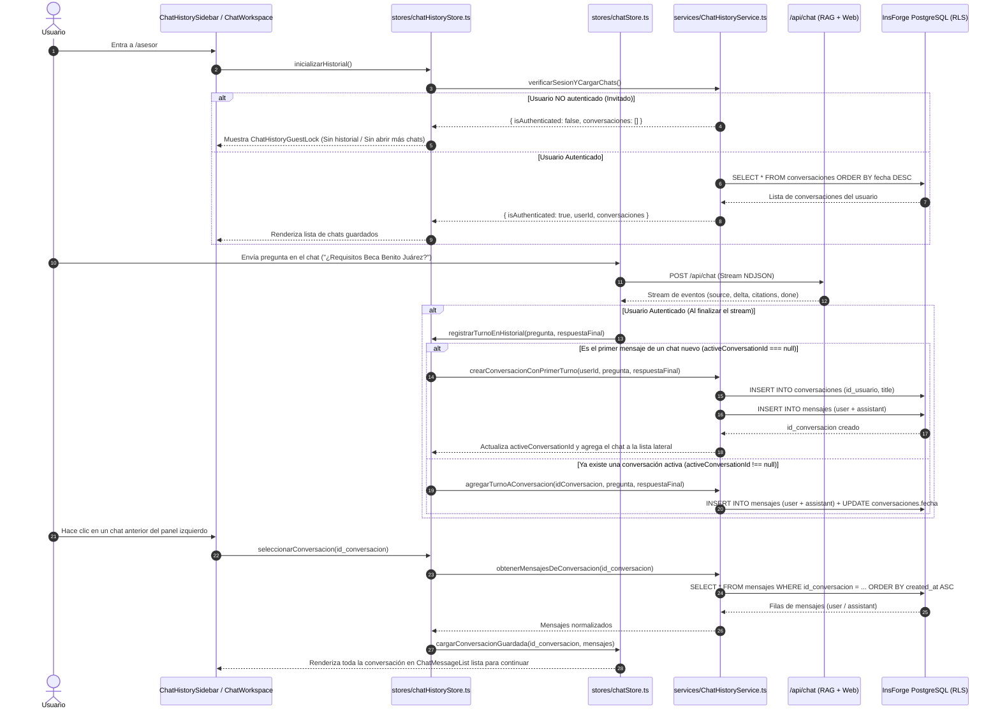
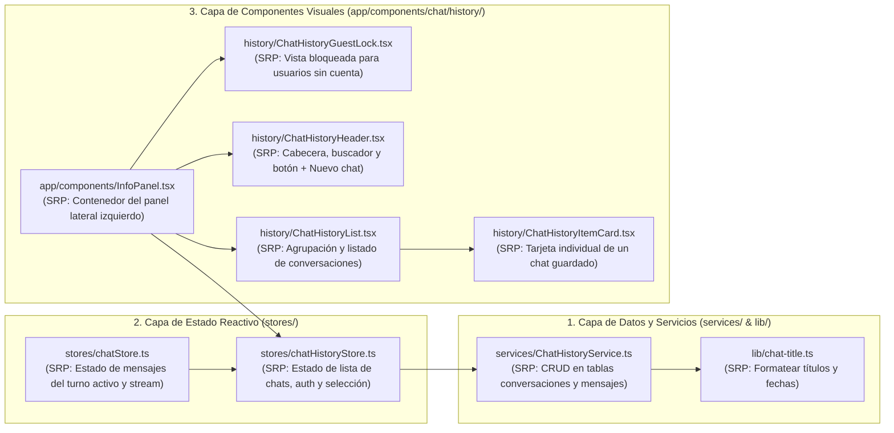

# Especificación Técnica y Documentación Detallada: Persistencia y Visualización del Historial de Chats (SRP)

> **Estado:** Especificación lista para implementación  
> **Alcance:** Persistencia en PostgreSQL (`public.conversaciones` y `public.mensajes` vía InsForge RLS), Servicio de Historial (`services/ChatHistoryService.ts`), Store de Historial (`stores/chatHistoryStore.ts`), Store de Chat Activo (`stores/chatStore.ts`), Componentes del Panel Lateral de Historial (`app/components/chat/history/*`) e Integración con `/asesor` y `/profile`.  
> **Principios rectores:** *Single Responsibility Principle (SRP)*, *React 19 / Next.js 16 Best Practices* y **Estética Blanco y Negro de Alto Contraste (`border-2 border-black`, `shadow-[4px_4px_0px_#000000]`)**.

---

## 1. Reglas de Negocio: Usuario Autenticado vs. Usuario Sin Cuenta (Invitado)

El comportamiento del historial y de la creación de conversaciones depende estrictamente de si el usuario tiene o no una sesión activa en InsForge Auth:

| Capacidad | Usuario Sin Cuenta (No Loggeado / Invitado) | Usuario Con Cuenta (Loggeado) |
|---|---|---|
| **Persistencia en Base de Datos** | **Deshabilitada.** Ningún mensaje se guarda en `public.conversaciones` ni en `public.mensajes`. | **Automática.** Cada turno (`user` y `assistant`) se guarda en tiempo real en PostgreSQL bajo su `id_usuario`. |
| **Visualización de Historial Lateral** | **Sin historial.** El panel izquierdo muestra un estado informativo bloqueado invitando a iniciar sesión o crear cuenta. | **Historial completo.** Lista sus conversaciones agrupadas, con buscador, fecha y conteo de mensajes. |
| **Abrir Nuevos Chats (`+ Nueva conversación`)** | **Bloqueado.** No se permite abrir múltiples chats ni reiniciar para acumular sesiones; solo cuenta con la sesión única temporal en curso. | **Habilitado.** Puede abrir tantos chats nuevos como necesite y alternar entre ellos en cualquier momento. |
| **Reabrir y Continuar Chats Pasados** | **No disponible.** | **Habilitado.** Al hacer clic en cualquier chat del panel izquierdo (o desde `/profile`), se cargan todos sus mensajes en pantalla y puede seguir conversando en ese mismo hilo. |

---

## 2. Explicación Paso a Paso del Proceso Técnico

A continuación se detalla cómo funciona todo el ciclo de vida de una conversación desde que el usuario entra a `/asesor`:

---

## 3. Arquitectura de Archivos Involucrados (Principio de Responsabilidad Única — SRP)

Para garantizar que el código sea **100% legible, mantenible y fácil de auditar**, cada archivo tiene asignada **una sola responsabilidad** y no mezcla lógica de base de datos, estado global ni interfaz gráfica:

### 3.1 Detalle Archivo por Archivo

#### A. Utilidades Puras (`lib/`)
1. **[`lib/chat-title.ts`](file:///home/josue-dev/university-projects/beca-bot/lib/chat-title.ts)** *(Nuevo)*
   - **Responsabilidad única:** Funciones puras sin efectos secundarios para:
     - Generar un título limpio y legible a partir de la primera pregunta del usuario (`generarTituloConversacion(pregunta: string): string`, máx. 60 caracteres).
     - Formatear fechas relativas en español de México (`formatearFechaChat(isoDate: string): string` → `"Hoy, 14:20"`, `"Ayer"`, `"4 nov"`).
     - Agrupar conversaciones por periodo (`agruparConversacionesPorFecha(conversaciones)` → `Hoy` vs `Anteriores`).

#### B. Servicios de Datos (`services/`)
2. **[`services/ChatHistoryService.ts`](file:///home/josue-dev/university-projects/beca-bot/services/ChatHistoryService.ts)** *(Nuevo)*
   - **Responsabilidad única:** Comunicarse exclusivamente con PostgreSQL a través del cliente autenticado de InsForge (`insforge.database`) respetando las políticas RLS (`conversaciones_propio_all` y `mensajes_propio_all`).
   - **Métodos expuestos:**
     - `listarConversaciones(userId: string)`: Obtiene todas las filas de `public.conversaciones` del usuario ordenadas por `fecha DESC`.
     - `obtenerMensajes(idConversacion: string)`: Obtiene los mensajes (`id_mensaje`, `mensaje`, `tipo`, `created_at`) de una conversación específica ordenados cronológicamente (`created_at ASC`).
     - `crearConversacion(userId: string, titulo: string)`: Inserta una nueva fila en `public.conversaciones` y devuelve su `id_conversacion`.
     - `guardarParMensajes(idConversacion: string, preguntaUsuario: string, respuestaAsistente: string)`: Inserta los 2 registros (`tipo: 'user'` y `tipo: 'assistant'`) en `public.mensajes` y actualiza el campo `fecha` de `public.conversaciones`.
     - `eliminarConversacion(idConversacion: string)`: Elimina la conversación en `public.conversaciones` (los mensajes asociados se eliminan automáticamente por `ON DELETE CASCADE`).

#### C. Stores de Estado (`stores/`)
3. **[`stores/chatHistoryStore.ts`](file:///home/josue-dev/university-projects/beca-bot/stores/chatHistoryStore.ts)** *(Nuevo)*
   - **Responsabilidad única:** Gestionar el estado del historial lateral y el estado de autenticación del chat:
     - `isAuthenticated: boolean` y `userId: string | null`.
     - `isLoadingHistory: boolean` y `isLoadingConversation: boolean`.
     - `conversaciones: ConversacionResumen[]` y `searchQuery: string`.
     - `activeConversationId: string | null`.
     - **Acciones:**
       - `initHistory()`: Verifica si hay usuario en `authService.obtenerUsuarioActual()` y carga su lista de conversaciones.
       - `selectConversation(idConversacion)`: Descarga los mensajes de esa conversación desde `chatHistoryService` y los inyecta en `useAIStore`.
       - `startNewConversation()`: **Verifica primero `isAuthenticated`**. Si el usuario no tiene sesión, **no permite abrir otro chat**. Si está autenticado, limpia `activeConversationId` y reinicia el lienzo de `useAIStore` para comenzar una conversación nueva.
       - `persistTurn(pregunta, respuesta)`: Si `isAuthenticated === true`, crea la conversación (si `activeConversationId === null`) y guarda el par de mensajes en la base de datos.
       - `deleteConversation(idConversacion)`: Elimina el chat de la lista y, si era el chat activo en pantalla, limpia el área de mensajes.

4. **[`stores/chatStore.ts`](file:///home/josue-dev/university-projects/beca-bot/stores/chatStore.ts)** *(Actualización)*
   - **Responsabilidad única:** Gestionar los mensajes en pantalla (`messages`), el estado de generación (`isGenerating`) y la lectura del stream `/api/chat`.
   - **Cambios puntuales:**
     - Añade la acción `setConversationMessages(messages: Message[])` para que `chatHistoryStore` pueda poblar los mensajes cuando el usuario selecciona un chat guardado.
     - Al finalizar exitosamente `generateResponse(prompt)`, invoca `useChatHistoryStore.getState().persistTurn(prompt, respuestaFinal)` para que el turno quede guardado si el usuario está autenticado.
     - En `resetChat()`, respeta la restricción de invitado: si el usuario no está autenticado, no permite abrir nuevas sesiones adicionales.

#### D. Componentes Visuales del Historial (`app/components/chat/history/`)
5. **[`app/components/InfoPanel.tsx`](file:///home/josue-dev/university-projects/beca-bot/app/components/InfoPanel.tsx)** *(Actualización)*
   - **Responsabilidad única:** Orquestar el panel izquierdo de `/asesor`:
     - Al montar, ejecuta `initHistory()`.
     - Si `isLoadingHistory` es `true`, muestra un skeleton limpio en blanco y negro.
     - Si `isAuthenticated === false`, renderiza `<ChatHistoryGuestLock />`.
     - Si `isAuthenticated === true`, renderiza `<ChatHistoryHeader />` + `<ChatHistoryList />`.

6. **[`app/components/chat/history/ChatHistoryGuestLock.tsx`](file:///home/josue-dev/university-projects/beca-bot/app/components/chat/history/ChatHistoryGuestLock.tsx)** *(Nuevo)*
   - **Responsabilidad única:** Mostrar la vista restringida cuando el usuario **no ha iniciado sesión**:
     - Explica claramente que en modo invitado **solo se permite la consulta actual** y **no se guarda historial ni se pueden abrir más chats**.
     - Presenta un botón deshabilitado con candado `🔒 + Nueva conversación (Requiere cuenta)` y botones de acción de alto contraste hacia **`Iniciar sesión` (`/login`)** y **`Crear cuenta gratis` (`/signup`)**.

7. **[`app/components/chat/history/ChatHistoryHeader.tsx`](file:///home/josue-dev/university-projects/beca-bot/app/components/chat/history/ChatHistoryHeader.tsx)** *(Nuevo)*
   - **Responsabilidad única:** Renderizar la cabecera del panel para usuarios autenticados:
     - Etiqueta `HISTORIAL DE CHATS` con contador total.
     - Botón **`+ Nueva conversación`** (habilitado para usuarios con cuenta, resalta cuando ya están en un lienzo nuevo).
     - Barra de búsqueda instantánea para filtrar conversaciones por título.

8. **[`app/components/chat/history/ChatHistoryList.tsx`](file:///home/josue-dev/university-projects/beca-bot/app/components/chat/history/ChatHistoryList.tsx)** *(Nuevo)*
   - **Responsabilidad única:** Recibir la lista filtrada de conversaciones, agruparlas en secciones (`HOY` y `ANTERIORES` usando `lib/chat-title.ts`) y renderizar cada elemento mediante `<ChatHistoryItemCard />` o un estado vacío si aún no tiene chats guardados.

9. **[`app/components/chat/history/ChatHistoryItemCard.tsx`](file:///home/josue-dev/university-projects/beca-bot/app/components/chat/history/ChatHistoryItemCard.tsx)** *(Nuevo)*
   - **Responsabilidad única:** Renderizar la tarjeta individual de una conversación guardada:
     - Si es la conversación actualmente abierta (`isActive === true`), se muestra con fondo negro y texto blanco (`border-2 border-black bg-black text-white shadow-[3px_3px_0px_#888888]`).
     - Si está en reposo, se muestra con fondo blanco/neutro (`border-2 border-black bg-white text-black hover:bg-neutral-100 shadow-[2px_2px_0px_#000000]`).
     - Incluye el botón `✕` para eliminar la conversación con confirmación inmediata sin recargar la página.

#### E. Integración con `/asesor` y `/profile`
10. **[`app/components/chat/ChatWorkspace.tsx`](file:///home/josue-dev/university-projects/beca-bot/app/components/chat/ChatWorkspace.tsx)** y **[`app/components/chat/ChatMessageList.tsx`](file:///home/josue-dev/university-projects/beca-bot/app/components/chat/ChatMessageList.tsx)** *(Actualización)*
    - **Soporte de URL `?chat=<id_conversacion>`:** Si el usuario hace clic en `"Abrir en Asesor ↗"` desde `/profile`, pasa `?chat=<id_conversacion>` y `ChatWorkspace` carga automáticamente los mensajes reales de esa conversación en lugar de enviar el título como una pregunta nueva.
    - **Restricción del botón `"Reiniciar chat"` en `ChatMessageList.tsx`:** Si el usuario no está autenticado (`!isAuthenticated`), en lugar de abrir un nuevo chat muestra un enlace directo **`Inicia sesión para abrir más chats →`** hacia `/login`.

---

## 4. Limpieza en Edge Function (`insforge/functions/ask.ts`)

En [`insforge/functions/ask.ts`](file:///home/josue-dev/university-projects/beca-bot/insforge/functions/ask.ts#L78-L85), actualmente existía un bloque que intentaba insertar en `conversaciones` y `mensajes` incluso cuando el RAG devolvía `FRASE_SIN_INFORMACION` (antes del fallback web).
- **Corrección SRP:** `ask.ts` se dedica **100% a recuperar contexto RAG y generar la respuesta del modelo**, mientras que `services/ChatHistoryService.ts` es el **único responsable** de persistir las conversaciones y los mensajes definitivos (provengan de RAG, Web o respuesta rápida). Esto evita registros duplicados o respuestas `"No tengo información..."` guardadas por error cuando el fallback Web sí respondió.

---

## 5. Criterios de Verificación

1. **Usuario sin sesión (Invitado):**
   - Ve en el panel izquierdo el bloque `<ChatHistoryGuestLock />`.
   - No tiene acceso al botón `+ Nueva conversación` ni en el panel lateral ni en la barra superior de la conversación.
   - Sus mensajes temporales no se escriben en la base de datos.
2. **Usuario con sesión (Autenticado):**
   - Al enviar una consulta, se crea automáticamente la conversación en `public.conversaciones` y aparece al instante en el panel izquierdo bajo el grupo **`HOY`**.
   - Al enviar más preguntas dentro del mismo hilo, todos los mensajes (`user` y `assistant`) se guardan bajo el mismo `id_conversacion`.
   - Al hacer clic en **`+ Nueva conversación`**, el área del chat se limpia para iniciar un tema nuevo, conservando el chat anterior en la barra lateral.
   - Al hacer clic en cualquier chat de la barra lateral (o al abrirlo desde `/profile` con `?chat=<id>`), se cargan todos sus mensajes previos y se puede continuar escribiendo sobre esa misma conversación.
3. **Estética consistente:**
   - Todos los componentes nuevos utilizan `border-2 border-black`, sombras sólidas `shadow-[4px_4px_0px_#000000]` y tipografía en blanco y negro de alto contraste.
