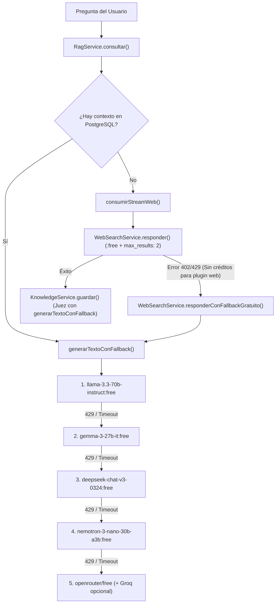

# Especificación: Rotación de Modelos Gratuitos (`:free`) y Optimización de Créditos en OpenRouter

## 1. Diagnóstico del Problema ("Se agotaron los tokens / créditos en ~5 preguntas")

En OpenRouter, el agotamiento prematuro de créditos o límites después de ~5 preguntas ocurría por **dos causas combinadas**:

1. **Ausencia del sufijo `:free` en los identificadores de modelo:**
   - Al invocar `nvidia/nemotron-3-nano-30b-a3b` sin el sufijo `:free`, OpenRouter enruta la petición al endpoint **de pago por token** en lugar del pool gratuito patrocinado.
   - Adicionalmente, cada pregunta que no está aún en el RAG ejecuta hasta 3 llamadas al LLM (1 en `RagService`, 1 en `WebSearchService` y 1 en `KnowledgeService` como Juez curador), multiplicando el consumo por 3 en cada turno.
2. **Consumo oculto del plugin de búsqueda web (`plugins: [{ id: "web", max_results: 5 }]`):**
   - En OpenRouter, aun cuando el modelo tenga el sufijo `:free`, el plugin `web` (impulsado por Exa) cobra **$0.004 USD por resultado** ($0.02 USD por consulta con `max_results: 5`). Con un saldo inicial de prueba o sin créditos recargados, después de 5 búsquedas en internet el saldo llega a `$0.00` y OpenRouter devuelve `402 Insufficient Credits` o `429 Rate Limit`.

---

## 2. Estrategias Implementadas

### Estrategia 1: Cadena de Rotación Automática de Modelos Gratuitos (`:free`) + Soporte Opcional de Groq

Se centralizó en [`lib/ai.ts`](../lib/ai.ts) la función `generarTextoConFallback`, que intenta generar la respuesta recorriendo en orden una lista curada de los mejores modelos gratuitos en español de OpenRouter:

1. `meta-llama/llama-3.3-70b-instruct:free` — Mejor seguimiento de instrucciones, formato Markdown y precisión en español.
2. `google/gemma-3-27b-it:free` — Alta velocidad, ventana de contexto amplia (128k) y excelente síntesis para RAG.
3. `deepseek/deepseek-chat-v3-0324:free` — Muy sólido en extracción estructurada JSON (ideal para `KnowledgeService`).
4. `nvidia/nemotron-3-nano-30b-a3b:free` — Variante explícitamente gratuita del modelo Nemotron 30B.
5. `openrouter/free` — Router comodín de OpenRouter que redirige automáticamente al modelo `:free` con menor congestión en ese segundo.

> **Soporte opcional para Groq (`GROQ_API_KEY`):**
> Si en `.env.local` se define la variable opcional `GROQ_API_KEY` (obtenible gratis sin tarjeta en `console.groq.com`), `generarTextoConFallback` utiliza como respaldo adicional la API ultrarrápida de Groq (`llama-3.3-70b-versatile`), la cual ofrece **14,400 peticiones gratuitas al día**.

---

### Estrategia 2: Optimización de Créditos en Búsqueda Web y Fallback sin Costo

En [`services/WebSearchService.ts`](../services/WebSearchService.ts) y [`lib/stream-emitter.ts`](../lib/stream-emitter.ts):

1. **Modelo explícitamente gratuito para la búsqueda web:** Se actualizó el modelo base a `nvidia/nemotron-3-nano-30b-a3b:free` para que los tokens de entrada/salida cuesten **$0.00**.
2. **Reducción del 60% en el consumo del plugin `web`:** Se redujo `max_results` de `5` a `2` (`plugins: [{ id: 'web', max_results: 2 }]`), manteniendo los 2 resultados oficiales más relevantes y triplicando la duración de cualquier saldo en OpenRouter.
3. **Respaldo automático 100% gratuito (`responderConFallbackGratuito`):** Si la cuenta de OpenRouter tiene `$0.00` créditos y el plugin `web` rechaza la petición (o si el modelo primario sufre rate-limit), [`lib/stream-emitter.ts`](../lib/stream-emitter.ts) captura la excepción de forma transparente e invoca `webSearchService.responderConFallbackGratuito(messages)`, respondiendo con la cadena de modelos `:free` sin interrumpir el chat del usuario.

---

## 3. Arquitectura y Archivos Involucrados (Principio de Responsabilidad Única - SRP)

| Archivo | Responsabilidad Única (SRP) |
| :--- | :--- |
| [`lib/ai.ts`](../lib/ai.ts) | Provee el cliente `openrouter`, la lista priorizada `MODELOS_GRATUITOS_OPENROUTER` y el ejecutor resiliente `generarTextoConFallback` con rotación automática entre modelos `:free` y respaldo opcional en Groq. |
| [`services/RagService.ts`](../services/RagService.ts) | Recupera los fragmentos vectoriales desde PostgreSQL y sintetiza la respuesta del RAG utilizando `generarTextoConFallback` (costo $0 en tokens). |
| [`services/KnowledgeService.ts`](../services/KnowledgeService.ts) | Evalúa con el Juez LLM (vía `generarTextoConFallback`) si la información obtenida es una beca mexicana válida y la guarda vectorizada en `public.conocimiento_web`. |
| [`services/WebSearchService.ts`](../services/WebSearchService.ts) | Configura la búsqueda web con modelo `:free` y `max_results: 2`, además de exponer `responderConFallbackGratuito` cuando no hay créditos para el plugin `web`. |
| [`lib/stream-emitter.ts`](../lib/stream-emitter.ts) | Consume el stream de búsqueda web y, ante cualquier error de cuota o límite de tasa del plugin web, conmuta automáticamente al fallback gratuito emitiendo los tokens por lotes al cliente. |

---

## 4. Flujo de Resiliencia ante Límites de Tasa o Falta de Créditos

