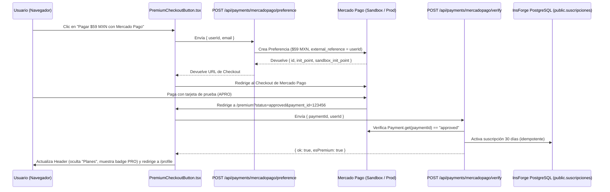

# Especificación Técnica: Pasarela de Pago con Mercado Pago (Checkout Pro + Sandbox Testing)

## 1. Objetivo General

Integrar **Mercado Pago México (`MXN`)** como pasarela de pagos oficial en **BecaBot** para activar la suscripción **Plan Premium ($59.00 MXN / 30 días)** en la tabla `public.suscripciones` de PostgreSQL (InsForge), respetando el **Principio de Responsabilidad Única (SRP)**, la seguridad de servidor (`insforgeAdmin`) y permitiendo probar todo el flujo extremo a extremo en **Modo Sandbox (Credenciales de Prueba de Mercado Pago)** sin usar dinero real.

---

## 2. Arquitectura y Flujo de Pago (Checkout Pro de Mercado Pago)

Se utilizará **Mercado Pago Checkout Pro (Preferences API)** mediante el SDK oficial `mercadopago` (v2) en el servidor de Next.js.

### ¿Por qué Checkout Pro?
1. **Soporte nativo en México (`MXN`):** Tarjetas de crédito/débito, saldo Mercado Pago, SPEI y OXXO.
2. **Doble vía de confirmación (Localhost + Producción):**
   - **Vía A — Retorno Síncrono (`back_urls` + `/api/payments/mercadopago/verify`):** Cuando el estudiante aprueba el pago en Mercado Pago y es redirigido de vuelta a `http://localhost:3000/premium?status=approved&payment_id=...`, el frontend invoca al servidor para consultar el estado real del `payment_id` directamente en la API de Mercado Pago (`Payment.get`) y activar el plan en `public.suscripciones`. **Esto permite probar en `localhost:3000` sin necesidad de exponer puertos con ngrok.**
   - **Vía B — Webhook Asíncrono (`/api/payments/mercadopago/webhook`):** En producción (o con túnel), Mercado Pago notifica directamente al servidor (`type: "payment"`), garantizando que incluso si el usuario cierra la pestaña antes de volver, su cuenta pase a Premium de forma idempotente.



---

## 3. Evolución de Base de Datos (Idempotencia de Pagos)

Actualmente `public.suscripciones` tiene las columnas:
- `id_suscripcion` (`UUID`)
- `id_usuario` (`UUID`)
- `estado` (`'activa' | 'cancelada' | 'vencida'`)
- `fecha_inicio` (`TIMESTAMPTZ`)
- `fecha_fin` (`TIMESTAMPTZ`)
- `is_first` (`BOOLEAN` — calculado automáticamente por el trigger `suscripcion_set_is_first`: si es su primera suscripción en la historia, incluso se le puede aplicar un precio promocional o registrar el primer pago)
- `precio_aplicado` (`NUMERIC`)
- `moneda` (`TEXT`)

### Manejo sin romper el esquema actual:
- `external_reference` en la preferencia de Mercado Pago llevará el `id_usuario` (`UUID`) del estudiante autenticado.
- En `metadata` de la preferencia de Mercado Pago se enviará `{ user_id, plan: "premium_mensual", payment_provider: "mercadopago" }`.
- Antes de activar una nueva suscripción al verificar un `payment_id`, el servidor valida:
  1. Que `payment.status === 'approved'`.
  2. Que `payment.external_reference === userId`.
  3. Cancela cualquier suscripción activa previa de ese `id_usuario` e inserta el nuevo registro en `public.suscripciones` con `estado: 'activa'`, `precio_aplicado: payment.transaction_amount` (`59.00`), `moneda: 'MXN'` y `fecha_fin: now() + 30 días`.

---

## 4. Responsabilidad Única de Archivos (SRP)

| Archivo | Responsabilidad Única (SRP) |
| :--- | :--- |
| [`lib/mercadopago.ts`](../lib/mercadopago.ts) | Inicializa y exporta el cliente `MercadoPagoConfig`, `Preference` y `Payment` usando `MP_ACCESS_TOKEN` de `.env.local` (con `dns.setDefaultResultOrder('ipv4first')`). |
| [`services/MercadoPagoService.ts`](../services/MercadoPagoService.ts) | Lógica de negocio en servidor: crear la preferencia de pago en `MXN`, consultar un `payment_id` en la API de Mercado Pago y activar la suscripción en `public.suscripciones` vía `insforgeAdmin`. |
| [`app/api/payments/mercadopago/preference/route.ts`](../app/api/payments/mercadopago/preference/route.ts) | Endpoint `POST` que recibe `{ userId, email }` y devuelve la URL de redirección (`init_point` / `sandbox_init_point`) de Mercado Pago. |
| [`app/api/payments/mercadopago/verify/route.ts`](../app/api/payments/mercadopago/verify/route.ts) | Endpoint `POST` que recibe `{ paymentId, userId }` al regresar de Mercado Pago (`back_urls`), valida con la API oficial de MP que el pago esté `approved` y activa el Plan Premium. |
| [`app/api/payments/mercadopago/webhook/route.ts`](../app/api/payments/mercadopago/webhook/route.ts) | Endpoint `POST` para notificaciones IPN/Webhook de Mercado Pago (`type === "payment"`), procesando la activación en segundo plano. |
| [`app/components/premium/MercadoPagoCheckoutButton.tsx`](../app/components/premium/MercadoPagoCheckoutButton.tsx) | Botón interactivo en `/premium` que verifica si el usuario inició sesión, solicita la preferencia de pago y redirige a Mercado Pago, además de procesar el retorno `?status=approved&payment_id=...`. |
| [`app/premium/page.tsx`](../app/premium/page.tsx) | Integra `MercadoPagoCheckoutButton` en la tarjeta del Plan Premium (manteniendo también `PremiumSimulatorBanner` para pruebas rápidas sin salir de la app). |

---

## 5. Variables de Entorno Requeridas (`.env.local`)

```bash
# Credenciales de Prueba (Sandbox) o Producción de Mercado Pago Developers México
MP_ACCESS_TOKEN="TEST-0000000000000000-000000-00000000000000000000000000000000-000000000"
NEXT_PUBLIC_MP_PUBLIC_KEY="TEST-00000000-0000-0000-0000-000000000000"

# URL base de la aplicación para los redireccionamientos (back_urls)
NEXT_PUBLIC_APP_URL="http://localhost:3000"
```

---

## 6. Plan de Pruebas Paso a Paso (Cómo probar Mercado Pago en Sandbox)

### Paso 1: Obtener las Credenciales de Prueba (`TEST-...`) en Mercado Pago
1. Ingresa a [Mercado Pago Developers](https://www.mercadopago.com.mx/developers/panel/app) con tu cuenta de Mercado Pago México.
2. Haz clic en **Crear aplicación** -> Nombre: `BecaBot` -> Producto: **Checkout Pro**.
3. En el menú izquierdo de tu aplicación, entra a **Credenciales de prueba** (*Test credentials*).
4. Copia el **Access Token** (`TEST-...`) y la **Public Key** (`TEST-...`) y pégalos en tu `.env.local` como `MP_ACCESS_TOKEN` y `NEXT_PUBLIC_MP_PUBLIC_KEY`.

### Paso 2: Importante sobre Cuentas en Modo Sandbox de Mercado Pago
> [!WARNING]
> **Regla de oro de Mercado Pago Sandbox:** No puedes pagar una preferencia creada con tu propio usuario vendedor usando el mismo correo logueado en Mercado Pago.
> - **Forma más rápida de probar (Sin cuenta comprador):** Cuando el botón de BecaBot abra la URL de Mercado Pago, ábrela o asegúrate de no tener iniciada tu sesión personal de Mercado Pago (o elige **"Pagar como invitado / Nueva tarjeta"**).

### Paso 3: Tarjetas de Prueba Oficiales (Mercado Pago México)
Al estar en el formulario de tarjeta de Mercado Pago Sandbox, introduce cualquiera de las siguientes tarjetas de prueba oficiales de México:

| Escenario a Probar | Número de Tarjeta (Visa / Mastercard Prueba) | Fecha Vencimiento | CVV | Nombre del Titular (Código de Estado) | Resultado Esperado |
| :--- | :--- | :--- | :--- | :--- | :--- |
| **Pago Aprobado (`approved`)** | `4009 1956 3222 177` *(o tarjeta de prueba generada en panel MP)* | `11/28` | `123` | **`APRO`** | Mercado Pago aprueba el cargo de $59 MXN, redirige a `/premium?status=approved&payment_id=...`, BecaBot verifica el pago real con `MP_ACCESS_TOKEN` y activa **PRO (30 días)**. |
| **Pago Rechazado por Fondos (`rejected`)** | Misma tarjeta de prueba | `11/28` | `123` | **`FUND`** | Mercado Pago rechaza el pago por fondos insuficientes. Al volver a `/premium?status=failure`, BecaBot muestra alerta de pago rechazado y mantiene al usuario en plan `Becario`. |
| **Pago Pendiente (`in_process` / `pending`)** | Misma tarjeta de prueba | `11/28` | `123` | **`CONT`** | Mercado Pago deja el pago pendiente de revisión. BecaBot informa al estudiante que su pago está en validación. |

### Paso 4: Verificación End-to-End en BecaBot tras un Pago `APRO`
1. Inicia sesión en BecaBot (`http://localhost:3000/login`) con tu usuario de prueba.
2. Ve a `http://localhost:3000/premium` y haz clic en **"Suscribirme con Mercado Pago ($59 MXN)"**.
3. Completa el pago en la pasarela de Mercado Pago con el titular **`APRO`**.
4. Al regresar automáticamente a `http://localhost:3000/premium?status=approved&payment_id=...`:
   - El componente [`MercadoPagoCheckoutButton`](../app/components/premium/MercadoPagoCheckoutButton.tsx) detecta el `payment_id` en la URL.
   - Llama a `POST /api/payments/mercadopago/verify`.
   - El servidor consulta a Mercado Pago (`Payment.get(paymentId)`), confirma `status === "approved"`, inserta la fila en `public.suscripciones` y emite el evento `becabot:subscription-updated`.
   - El **Header** oculta la pestaña `"Planes"`, aparece el badge **`PRO`** junto a tu `@usuario`, y en `/asesor` puedes agendar recordatorios por correo inmediatamente.
