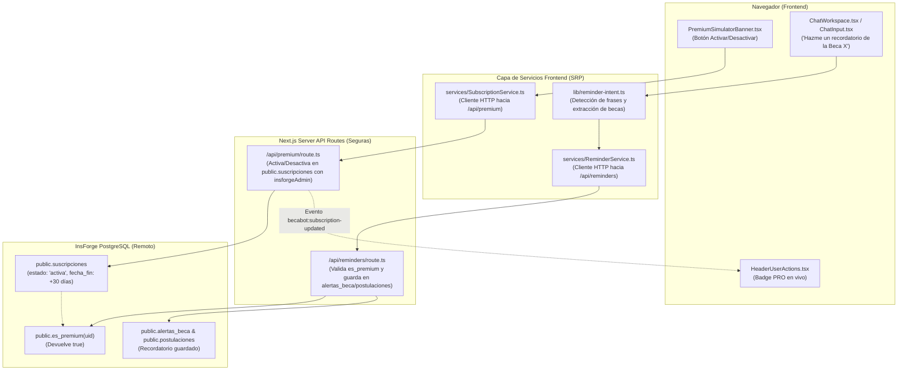

# Diagnóstico, Solución Técnica y Guía de Operación: Activación de Cuentas Premium y Recordatorios en el Chat

> **Estado:** Implementado, corregido y verificado con `pnpm run build` (Next.js 16.3.5 Turbopack con 0 errores).  
> **Alcance:** Endpoints seguros de servidor (`/api/premium` y `/api/reminders`), Servicio de Suscripción (`SubscriptionService.ts`), Servicio de Recordatorios (`ReminderService.ts`), Detector de Intenciones (`reminder-intent.ts`), Sincronización en vivo del Header (`HeaderUserActions.tsx`) y Vistas (`/premium`, `/profile`, `/asesor`).  
> **Arquitectura:** Cumplimiento estricto del *Principio de Responsabilidad Única (SRP)*.

---

## 1. Causa Raíz del Problema Anterior

### ¿Por qué al presionar "Activar Premium" se desactivaba al instante?
1. **Restricción de Row-Level Security (RLS) en PostgreSQL:**  
   En el esquema original de InsForge (`20261013214445_becabot-schema.sql` líneas 418-422), la tabla `public.suscripciones` tiene la siguiente política:
   ```sql
   REVOKE INSERT, UPDATE, DELETE ON public.suscripciones FROM anon, authenticated;
   ```
   Esto significa que el navegador (usando la clave anónima del usuario loggeado) **tiene prohibido por base de datos insertar o actualizar registros en `suscripciones`**.
2. **Fallo silencioso en el cliente:**  
   Cuando el simulador intentaba hacer `insert` directo o ejecutar una función RPC que no estaba aún migrada en el motor remoto, PostgreSQL rechazaba la escritura con error 404/403. Al no quedar registrada la fila activa en la base de datos, el siguiente chequeo reactivo leía que el usuario seguía sin suscripción activa, volviendo el botón de inmediato a "Becario (Free)".

---

## 2. Solución Arquitectónica Implementada (SRP)

Para resolverlo de raíz sin debilitar las políticas de seguridad RLS de la base de datos, la escritura privilegiada se trasladó a **Route Handlers seguros en Next.js** que utilizan la clave de administración (`INSFORGE_API_KEY`) del servidor:



---

## 3. Detalle Archivo por Archivo de la Implementación

| Archivo | Responsabilidad Única (SRP) | ¿Qué hace exactamente? |
|---|---|---|
| **[`lib/insforge-admin.ts`](file:///home/josue-dev/university-projects/beca-bot/lib/insforge-admin.ts)** | Cliente Servidor Privilegiado | Inicializa una instancia de `@insforge/sdk` en el servidor usando `INSFORGE_API_KEY`, permitiendo escribir en tablas de backend sin restricciones de RLS. |
| **[`app/api/premium/route.ts`](file:///home/josue-dev/university-projects/beca-bot/app/api/premium/route.ts)** | Controlador de Suscripción en Servidor | Endpoint `POST /api/premium`. Recibe `{ userId, action: 'activate' | 'deactivate', days }`. Cancela suscripciones previas e inserta una suscripción activa por 30 días con precio de $49 MXN. Al desactivar, cancela la suscripción activa. |
| **[`app/api/reminders/route.ts`](file:///home/josue-dev/university-projects/beca-bot/app/api/reminders/route.ts)** | Controlador de Recordatorios en Servidor | Endpoint `POST /api/reminders`. Recibe `{ userId, nombreBeca }`. Verifica vía RPC `public.es_premium(userId)`. Si es `false`, devuelve error `403 PREMIUM_REQUIRED`. Si es `true`, busca o registra la beca en `public.becas`, crea la postulación pendiente y guarda la alerta en `public.alertas_beca` con avisos `[30, 7, 1]` días antes. |
| **[`services/SubscriptionService.ts`](file:///home/josue-dev/university-projects/beca-bot/services/SubscriptionService.ts)** | Adaptador de Suscripción Frontend | Llama a `/api/premium`, verifica el estado y dispara el evento del DOM `becabot:subscription-updated` para que la UI se refresque instantáneamente. |
| **[`services/ReminderService.ts`](file:///home/josue-dev/university-projects/beca-bot/services/ReminderService.ts)** | Orquestador de Recordatorios Frontend | Valida si el usuario está loggeado y si es Premium. Llama a `/api/reminders` y formatea la respuesta en Markdown de confirmación con los datos de la beca y enlace a `/profile`. |
| **[`lib/reminder-intent.ts`](file:///home/josue-dev/university-projects/beca-bot/lib/reminder-intent.ts)** | Clasificador y Extractor de Intención | Detecta frases como *"hazme un recordatorio..."*, *"quiero un recordatorio..."*, *"pon una alerta..."*, *"recuérdame..."*. Si el usuario no menciona el nombre en ese mensaje, busca hacia atrás en el historial las citas o menciones previas de becas. |
| **[`app/components/header/HeaderUserActions.tsx`](file:///home/josue-dev/university-projects/beca-bot/app/components/header/HeaderUserActions.tsx)** | Estado de Sesión en Header | Escucha el evento `becabot:subscription-updated`. Al activarse Premium, el badge **`PRO`** aparece inmediatamente al lado del `@username` sin necesidad de recargar la página. |
| **[`app/components/premium/PremiumSimulatorBanner.tsx`](file:///home/josue-dev/university-projects/beca-bot/app/components/premium/PremiumSimulatorBanner.tsx)** | UI de Pruebas de 1 Clic | Panel en `/premium` y `/profile` para alternar entre "Becario (Free)" y "Premium (PRO)". Ahora conserva el estado de manera persistente en PostgreSQL. |
| **[`app/components/chat/ChatMessageItem.tsx`](file:///home/josue-dev/university-projects/beca-bot/app/components/chat/ChatMessageItem.tsx)** | Renderizado de Citas y Acciones | Renderiza un botón rápido `🔔 Recordatorio` debajo de cada fuente oficial citada en una respuesta para agendarla con un solo clic. |

---

## 4. Guía Paso a Paso para Probarlo

### Paso 1: Activar el Plan Premium
1. Inicia sesión con tu cuenta en **/login** (ej. tu usuario actual).
2. Entra a **/premium** o a **/profile**.
3. En la tarjeta **"Simulador de Suscripción Premium"**, haz clic en el botón negro:
   > **`⚡ Activar Plan Premium (Modo Prueba)`**
4. **Verificación:**
   - La tarjeta cambiará permanentemente a: **`Estado: Premium (PRO)`** con punto verde esmeralda.
   - En el Header superior derecho, tu botón de perfil ahora muestra la insignia negra **`PRO`**.
   - En **/profile**, la sección de suscripción indicará **`BecaBot Premium Activo`** y se desbloqueará el panel de **`Tus Recordatorios y Alertas de Becas`**.

### Paso 2: Probar el Guardado de Recordatorios en el Chat (`/asesor`)
1. Ve al asesor en **/asesor**.
2. Escribe directamente cualquiera de las siguientes opciones:
   - **Opción A (Nombre explícito):**
     > *"Hazme un recordatorio para la Beca Benito Juárez"*
   - **Opción B (Contextual):**
     > Pregunta: *"¿Qué becas hay para preparatoria?"*  
     > Y cuando te responda, escribe: *"Hazme un recordatorio de esta beca"* (o haz clic en el botón **`🔔 Recordatorio`** que aparece debajo de las fuentes citadas).
3. **Resultado en el Chat:**
   BecaBot responderá con la confirmación oficial:
   > ✅ **¡Recordatorio agendado exitosamente en tu Perfil Premium!**  
   > 📌 **Beca:** Beca Benito Juárez  
   > 📅 **Fecha de cierre prevista:** ...  
   > 🔔 **Alertas programadas a tu correo:** 30 días, 7 días y 24 horas antes del vencimiento.  
   > [Expediente en Mi Perfil](/profile)

### Paso 3: Verificar que el Recordatorio se Guardó en tu Perfil
1. Haz clic en el enlace o ve directamente a **/profile**.
2. Desplázate a la sección **"Tus Recordatorios y Alertas de Becas"**.
3. **Resultado:**
   - Verás la tarjeta de la beca con su nombre, fecha límite y el botón negro **`Alerta activa ✓`** (el cual puedes pausar o reanudar cuando desees).

### Paso 4: Probar el Bloqueo cuando se Desactiva Premium
1. En **/profile** o **/premium**, haz clic en **`Cambiar a Plan Becario (Desactivar PRO)`**.
2. El badge `PRO` del header desaparecerá.
3. Vuelve a **/asesor** y escribe: *"Hazme un recordatorio para la Beca Santander"*.
4. **Resultado:** BecaBot te responderá que los recordatorios son exclusivos del Plan Premium y te invitará a activarlo con el enlace a `/premium`.
