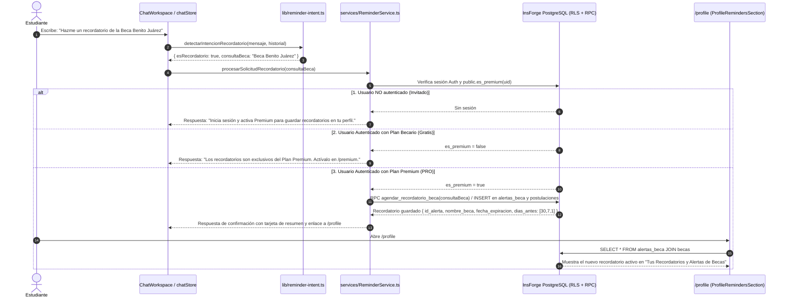
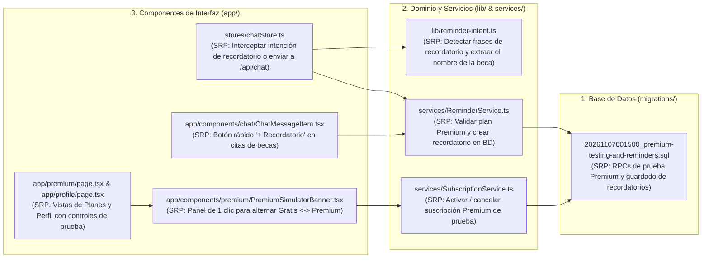

# Especificación Técnica y Guía de Pruebas: Cuentas Premium, Recordatorios desde el Chat y Visualización en `/profile` (SRP)

> **Estado:** Especificación lista para implementación  
> **Alcance:** Detección de intención de recordatorios en el Chatbot (`lib/reminder-intent.ts`), Servicio de Recordatorios (`services/ReminderService.ts`), Servicio de Suscripción y Simulador de Pruebas (`services/SubscriptionService.ts`), Migración SQL (`migrations/20261107001500_premium-testing-and-reminders.sql`), Integración en `/asesor`, `/premium` y `/profile`.  
> **Principios rectores:** *Single Responsibility Principle (SRP)*, *Seguridad por RLS en PostgreSQL* y **Estética Blanco y Negro de Alto Contraste (`border-2 border-black`, `shadow-[4px_4px_0px_#000000]`)**.

---

## 1. Objetivo del Módulo

1. **Agendar Recordatorios desde el Chatbot (`/asesor`) — Exclusivo Premium:**
   - Cuando un usuario escribe en el chat que desea crear o guardar un recordatorio de una beca (ej. *"Hazme un recordatorio para la Beca Benito Juárez"*, *"Recuérdame la convocatoria de Jóvenes Escribiendo el Futuro"*, *"Quiero agendar una alerta de esta beca"*):
     - **Si tiene Plan Premium activo (`es_premium = true`):** El sistema identifica la beca mencionada (en el mensaje actual o en el contexto de la conversación), guarda el recordatorio en las tablas `public.alertas_beca` y `public.postulaciones` en PostgreSQL y responde confirmando los detalles (`Nombre de la beca`, `Fecha de cierre`, `Avisos 30, 7 y 1 día antes`). El recordatorio aparece inmediatamente en su página **`/profile`**.
     - **Si tiene Plan Becario (Gratuito, `es_premium = false`):** El chatbot detecta la solicitud pero **no guarda el recordatorio**; le explica que los recordatorios automáticos son exclusivos del **Plan Premium** y le muestra el enlace directo a **`/premium`** para activar su suscripción.
     - **Si no ha iniciado sesión (Invitado):** El chatbot le indica que necesita iniciar sesión y contar con el **Plan Premium** para guardar recordatorios en su perfil.
2. **Botón Rápido `+ Guardar recordatorio` en Respuestas del Chat:**
   - Además de pedirlo por texto, en las respuestas del asistente que incluyan becas citadas se mostrará un botón de acción rápida para agendar el recordatorio con un clic (validando igualmente que sea usuario Premium).
3. **Mecanismo de Prueba para Activar / Desactivar Premium sin Pasarela de Pago Externa:**
   - Dado que actualmente la tabla `public.suscripciones` tiene bloqueado el `INSERT/UPDATE` directo desde el cliente por RLS, se implementará un **Modo de Prueba / Simulador de Suscripción Seguro (`SECURITY DEFINER` RPC)** conectado a un panel interactivo en **`/premium`** y **`/profile`**.
   - Esto permitirá cambiar con **1 clic** entre **Plan Becario (Gratis)** y **Plan Premium Activo (`PRO`)** en tiempo real para probar todos los casos de uso.

---

## 2. Flujo Completo del Proceso (Diagrama de Secuencia)

---

## 3. Arquitectura de Archivos Involucrados (Principio de Responsabilidad Única — SRP)

Cada archivo tiene **una única responsabilidad** claramente separada para mantener el código limpio y legible:

### 3.1 Explicación Detallada Archivo por Archivo

#### 1. Migración SQL (`migrations/20261107001500_premium-testing-and-reminders.sql`) *(Nuevo)*
- **Responsabilidad única:** Proveer las funciones PostgreSQL seguras (`SECURITY DEFINER`) para:
  1. **`public.activar_premium_demo(p_dias int DEFAULT 30)`**:
     - Toma el usuario autenticado `auth.uid()`.
     - Si ya tenía una suscripción activa, actualiza su `fecha_fin`; de lo contrario, inserta una fila en `public.suscripciones` con `estado = 'activa'`, `fecha_inicio = now()`, `fecha_fin = now() + (p_dias || ' days')::interval`, `precio_aplicado = 49.00`, `moneda = 'MXN'`.
     - Con esto, `public.es_premium(auth.uid())` devuelve inmediatamente `true` y todas las políticas RLS de `alertas_beca` y `postulaciones` quedan habilitadas de forma nativa.
  2. **`public.desactivar_premium_demo()`**:
     - Marca como `'cancelada'` cualquier suscripción activa de `auth.uid()` y ajusta `fecha_fin = now() - interval '1 second'`.
     - `public.es_premium(auth.uid())` vuelve inmediatamente a `false` para poder probar el bloqueo del Plan Becario.
  3. **`public.crear_recordatorio_desde_texto(p_nombre_beca text)`**:
     - Verifica primero `public.es_premium(auth.uid())`. Si es `false`, lanza excepción `'PREMIUM_REQUIRED'`.
     - Busca en `public.becas` la beca que mejor coincida con `p_nombre_beca` (por `ILIKE` o similitud). Si la beca mencionada en el chat aún no existe en la tabla `public.becas` (por ejemplo, una convocatoria encontrada por búsqueda web), la registra en `public.becas` con su nombre para que pueda vincularse por llave foránea (`id_beca`).
     - Inserta/actualiza en `public.postulaciones` (`estado = 'pendiente'`) y en `public.alertas_beca` (`dias_antes = '{30,7,1}'`, `canal = 'email'`, `activa = true`) y devuelve los datos completos del recordatorio creado.

#### 2. Detector de Intención de Recordatorios (`lib/reminder-intent.ts`) *(Nuevo)*
- **Responsabilidad única:** Analizar de forma pura el texto del usuario y el historial reciente de la conversación para determinar:
  1. ¿El usuario está pidiendo crear/guardar un recordatorio o alerta?
     - Detecta patrones en español como: *"hazme un recordatorio..."*, *"recuérdame..."*, *"quiero un recordatorio..."*, *"guardar recordatorio..."*, *"pon una alerta..."*, *"avísame cuando cierre..."*, *"agendar recordatorio..."*.
  2. ¿Para qué beca lo solicita?
     - Si el mensaje incluye el nombre (ej. *"hazme un recordatorio para la Beca Benito Juárez"*), extrae `"Beca Benito Juárez"`.
     - Si el mensaje es de referencia contextual (ej. *"hazme un recordatorio de esta beca"* o *"sí, guárdame un recordatorio"*), inspecciona los últimos mensajes de la conversación (`citations` o títulos en negritas del asistente) para obtener el nombre exacto de la beca de la que estaban hablando.

#### 3. Servicio de Suscripción (`services/SubscriptionService.ts`) *(Nuevo)*
- **Responsabilidad única:** Gestionar la activación, cancelación y consulta del estado Premium del usuario autenticado llamando a los RPCs `activar_premium_demo`, `desactivar_premium_demo` y `es_premium` en InsForge, además de emitir un evento de sincronización (`window.dispatchEvent(new Event('becabot:subscription-updated'))`) para que el Header (`PRO`) y las vistas se actualicen al instante sin recargar toda la aplicación.

#### 4. Servicio de Recordatorios (`services/ReminderService.ts`) *(Nuevo)*
- **Responsabilidad única:** Ejecutar la lógica de negocio cuando se solicita un recordatorio desde el chat:
  1. Verifica si el usuario tiene sesión activa (`authService.obtenerUsuarioActual()`).
  2. Verifica si el usuario es Premium (`es_premium`).
  3. Si **no está autenticado** o **no es Premium**, devuelve un mensaje estructurado indicando la restricción y el enlace de acción (`/login` o `/premium`).
  4. Si **es Premium**, invoca el guardado del recordatorio (vía RPC `crear_recordatorio_desde_texto` o inserción directa en `alertas_beca` / `postulaciones` si la migración aún no se ha corrido, con fallback automático sobre `public.becas`) y devuelve el mensaje Markdown de confirmación con los datos de la beca y enlace directo a `/profile`.

#### 5. Integración en el Store del Chat (`stores/chatStore.ts`) y Citas (`app/components/chat/ChatMessageItem.tsx`)
- **`stores/chatStore.ts`**:
  - Antes de llamar a `/api/chat`, consulta `detectarIntencionRecordatorio(prompt, get().messages)`.
  - Si el usuario está pidiendo un recordatorio, delega la ejecución a `reminderService.procesarSolicitudEnChat(consultaBeca)`, muestra la respuesta en el flujo de mensajes y, si el usuario está autenticado, **también guarda el turno en el historial de chats (`chatHistoryStore.persistTurn`)**.
- **`app/components/chat/ChatMessageItem.tsx`**:
  - Junto a cada fuente oficial citada en una respuesta de BecaBot, agrega un botón **`🔔 Crear recordatorio`** que dispara `generateResponse("Hazme un recordatorio para la beca " + fuente.title)` para probarlo también con un solo clic.

#### 6. Panel Simulador de Pruebas Premium (`app/components/premium/PremiumSimulatorBanner.tsx`) *(Nuevo)*
- **Responsabilidad única:** Proveer una tarjeta de control clara (con estética Neo-Brutalist en blanco y negro) dentro de **`/premium`** y **`/profile`** que muestra:
  - El estado actual de tu cuenta (`PLAN BECARIO GRATUITO` vs `PLAN PREMIUM ACTIVO`).
  - Un botón de **1 clic** para **`⚡ Activar Plan Premium (Modo Prueba)`** o **`Cambiar a Plan Becario (Modo Prueba)`**, permitiendo probar inmediatamente ambos escenarios sin necesidad de tarjeta bancaria.

---

## 4. ¿Cómo Podrás Probar Todo el Flujo Paso a Paso?

Una vez implementada esta especificación, podrás probar los **3 escenarios** de forma inmediata:

### Escenario A: Probar bloqueo como Usuario Gratuito (Plan Becario)
1. Inicia sesión con tu cuenta en `/login` (por defecto inicia en **Plan Becario**).
2. Ve al chatbot en `/asesor` y escribe:
   > *"Hazme un recordatorio para la Beca Benito Juárez"*
3. **Resultado esperado:** BecaBot te responderá que los recordatorios automáticos son exclusivos del **Plan Premium**, no guardará la alerta en base de datos y te dará el enlace a `/premium`.

### Escenario B: Activar Premium en 1 Clic (Modo Prueba)
1. Entra a **`/premium`** (o a **`/profile`**).
2. En el panel **`Simulador de Suscripción (Modo Prueba)`**, haz clic en **`⚡ Activar Plan Premium (30 días gratis de prueba)`**.
3. **Resultado esperado:**
   - En el Header superior aparecerá inmediatamente la insignia **`PRO`** junto a tu `@username`.
   - En `/profile` tu tarjeta cambiará a **`Plan Premium Activo`**.

### Escenario C: Crear Recordatorio desde el Chat siendo Premium y Verlo en `/profile`
1. Con el **Plan Premium Activo**, ve a **`/asesor`** y escribe cualquiera de estas frases:
   - *"Hazme un recordatorio para la Beca Benito Juárez"*
   - O primero pregunta *"¿Qué becas hay para licenciatura?"* y cuando te responda escribe: *"Guárdame un recordatorio de esa beca"* (o haz clic en el botón **`🔔 Recordatorio`** debajo de la respuesta).
2. **Resultado esperado:**
   - BecaBot confirmará en el chat: **¡Recordatorio guardado en tu Perfil Premium!** mostrando el nombre de la beca, fecha límite y avisos (`30, 7 y 1 día antes`).
   - Haz clic en **`Ir a Mi Perfil` (`/profile`)** y verás la beca listada dentro de la sección **`Tus Recordatorios y Alertas de Becas`** con su botón `Alerta activa ✓`.
