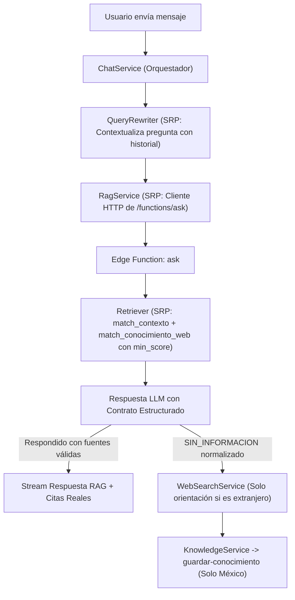

# Especificación Técnica: Corrección Integral del Sistema RAG y Reglas de Ámbito (México)

> **Estado:** Especificación aprobada para implementación  
> **Alcance:** Base de datos (`pgvector` / RPCs), Edge Functions de InsForge (`ask`, `guardar-conocimiento`, `ingest-beca`), Servicios Backend (`RagService`, `ChatService`, `WebSearchService`, `KnowledgeService`) y Sistema de Prompts (`lib/prompts.ts`).  
> **Principio rector:** *Single Responsibility Principle (SRP)* — cada módulo, función SQL y servicio tiene una única razón para cambiar.

---

## 1. Resumen del Problema

El sistema RAG actual de **BecaBot** presenta 8 fallas estructurales que provocan dos síntomas críticos:
1. **Falsos negativos (No recupera información que sí existe en la BD):** El bot responde *"No tengo esa información en mis documentos"* y salta innecesariamente a la búsqueda web aun cuando la beca, sus requisitos o sus fechas sí están registrados en PostgreSQL.
2. **Falsos positivos y contaminación de ámbito:** Devuelve respuestas vacías como si fueran válidas del RAG, inyecta ruido con baja similitud semántica, pierde el hilo en preguntas de seguimiento (*"¿y cuáles son sus requisitos?"*) o permite respuestas detalladas sobre becas fuera de México.

---

## 2. Diagnóstico Detallado de Fallas y Soluciones Propuestas



---

### 2.1 Falla 1: Pérdida de contexto semántico en `requisitos` y `beca_chunks`

#### Causa actual
En [`insforge/functions/ingest-beca.ts`](file:///home/josue-dev/university-projects/beca-bot/insforge/functions/ingest-beca.ts#L78-L114), cuando se generan los vectores de `requisitos` y `beca_chunks`, se embebe únicamente el texto aislado del requisito (ej. `"Promedio mínimo de 8.5"`). Cuando el usuario pregunta *"¿Qué requisitos pide la Beca Benito Juárez?"*, el embedding de la consulta tiene un peso alto en `"Beca Benito Juárez"`, por lo que en el `UNION ALL` de [`match_contexto`](file:///home/josue-dev/university-projects/beca-bot/migrations/20261013214445_becabot-schema.sql#L195-L253) las filas de `requisitos` obtienen un `score` bajo y quedan fuera del `LIMIT 5`.

#### Solución (SRP: Enriquecimiento semántico en la ingesta y recuperación)
1. **Al ingerir (`ingest-beca.ts`):** Prefijar el contexto de la beca en el texto que se envía a `generarEmbeddings` (manteniendo limpio el texto visible o enriqueciendo el input del embedding):
   - Para cada chunk: `Beca: ${name} (${grado ?? 'General'})\n${chunk}`
   - Para cada requisito: `Requisito de la beca ${name} (${grado ?? 'General'}): ${requisito}`
2. **En la consulta SQL (`match_contexto`):** Además de los top candidatos por similitud vectorial, si una beca sale seleccionada en el top de `becas` o `beca_chunks`, adjuntar sus requisitos asociados y metadatos (`grado_academico`, `fecha_expiracion`) para que el LLM nunca reciba una beca truncada sin sus requisitos o sin su fecha límite.

---

### 2.2 Falla 2: La columna `fecha_expiracion` y `grado_academico` no se entregan al LLM y las becas vencidas desaparecen

#### Causa actual
En [`migrations/20261013214445_becabot-schema.sql`](file:///home/josue-dev/university-projects/beca-bot/migrations/20261013214445_becabot-schema.sql#L212-L252):
- `match_contexto` devuelve únicamente `(id_beca, name, tipo_fuente, content, score)`. **No devuelve `fecha_expiracion` ni `grado_academico`**. Si la fecha límite solo está en la columna `fecha_expiracion` y no escrita dentro de `description`, el LLM jamás la ve y responde `SIN_INFORMACION`.
- Además, el filtro `AND (b.fecha_expiracion IS NULL OR b.fecha_expiracion >= public.hoy_mx())` oculta por completo cualquier beca cuya fecha haya pasado, haciendo creer al RAG que la beca no existe en la base de datos.

#### Solución (Migración SQL de actualización de `match_contexto`)
Modificar `public.match_contexto` para:
1. Retornar columnas explícitas de metadatos o incluirlas en el bloque de contexto: `grado_academico`, `fecha_expiracion`, y un booleano calculado `vigente` (`b.fecha_expiracion IS NULL OR b.fecha_expiracion >= public.hoy_mx()`).
2. **No eliminar silenciosamente** las becas con `fecha_expiracion < hoy_mx()`; en su lugar, penalizar ligeramente su score o etiquetarlas claramente en el contexto como `[CONVOCATORIA CERRADA - Fecha límite fue: YYYY-MM-DD]` para que el bot pueda informar los requisitos históricos de la beca aclarando que la convocatoria actual ya cerró.

---

### 2.3 Falla 3: Ausencia de umbral de similitud (`min_score`) y contaminación por `conocimiento_web`

#### Causa actual
- `match_contexto` siempre devuelve 5 filas y `match_conocimiento_web` siempre devuelve 3 filas, sin importar si el `score` es `0.15` (ruido total).
- En [`insforge/functions/ask.ts`](file:///home/josue-dev/university-projects/beca-bot/insforge/functions/ask.ts#L148-L153), `contextoWeb` se coloca antes que `contextoBecas` y se ordena usar `[web]` como fuente principal.
- En las líneas 172–185 de `ask.ts`, se devuelven como `fuentes` **todos** los registros recuperados (hasta 8), aunque tengan `score` irrelevante y el LLM no los haya utilizado.

#### Solución
1. **Parámetro `min_score` en RPCs:**
   - En `match_contexto`: agregar parámetro `min_score double precision DEFAULT 0.38` y filtrar `WHERE c.score >= min_score`.
   - En `match_conocimiento_web`: agregar parámetro `min_score double precision DEFAULT 0.45` y filtrar `WHERE (1 - (c.embedding <=> query_embedding)) >= min_score`.
2. **Prioridad de fuentes:** Las becas estructuradas oficiales (`[beca]` / `[requisito]`) tienen prioridad sobre `[web]`. El conocimiento web solo complementa cuando tiene un `score` alto.
3. **Filtrado de citas (`fuentes`):** Solo devolver en `fuentes` aquellas cuyo `score` supere el umbral y deduplicar por `id_beca` / `name` antes de enviarlas al cliente.

---

### 2.4 Falla 4: Ceguera conversacional en preguntas de seguimiento (Multi-turno)

#### Causa actual
En [`services/ChatService.ts`](file:///home/josue-dev/university-projects/beca-bot/services/ChatService.ts#L81-L96), solo se extrae el último mensaje del usuario (`pregunta`) y se envía a `ragService.consultar(pregunta)`. Ni el historial reciente ni el token de sesión llegan a `/functions/ask`. Si el usuario pregunta *"¿Y cuánto dan?"* después de hablar de una beca, el embedding de *"¿Y cuánto dan?"* no recupera la beca anterior.

#### Solución (SRP: Contextualizador de consulta + Historial reciente)
1. Crear un módulo con responsabilidad única [`lib/query-context.ts`](file:///home/josue-dev/university-projects/beca-bot/lib/query-context.ts) que construya una `preguntaContextualizada` para la búsqueda vectorial combinando la pregunta actual con el contexto inmediato de los últimos turnos del usuario/asistente cuando la pregunta actual es corta o anafórica (ej. *"¿Cuáles son los requisitos?"*, *"¿Y cuándo cierra?"*, *"¿Cuánto pagan?"*).
2. Pasar también los últimos mensajes (`historialReciente`) en el body de `RagService.consultar(pregunta, historial, gradoAcademico)` hacia `ask.ts` para que el LLM del RAG mantenga el hilo conversacional incluso para usuarios no autenticados.

---

### 2.5 Falla 5: Fragilidad en la detección de `SIN_INFORMACION`

#### Causa actual
[`insforge/functions/ask.ts`](file:///home/josue-dev/university-projects/beca-bot/insforge/functions/ask.ts#L169) evalúa `if (respuesta.includes('No tengo esa información en mis documentos.'))`.
- Si el LLM omite la tilde (`informacion`), cambia una palabra o responde `"En el contexto no se menciona..."`, `.includes()` da `false`, `fuentes` conserva los elementos del RPC, y `ChatService.ts` muestra al usuario una negativa sin activar la búsqueda web.
- Si el LLM responde correctamente pero al final añade `"No tengo esa información en mis documentos respecto al monto exacto"`, `.includes()` da `true` y descarta toda la respuesta válida.

#### Solución (SRP: Evaluador normalizado de respuesta RAG)
Crear un helper dedicado `esRespuestaSinInformacion(texto: string): boolean` compartido en `_shared/text.ts` y `lib/chat-stream.ts`:
1. Normalizar texto con `.normalize('NFD').replace(/[\u0300-\u036f]/g, '').toLowerCase().trim()`.
2. Usar un token centinela inequívoco en el prompt del sistema de `ask.ts`: `[[SIN_INFORMACION]]` cuando el contexto no contenga información para responder la consulta, además de detectar variantes normalizadas de `"no tengo esa informacion en mis documentos"` solo cuando constituyen la respuesta principal (p. ej. longitud corta `< 140` caracteres).
3. En `ChatService.ts`, verificar `if (rag.fuentes.length > 0 && !rag.sinInformacion)` antes de marcar `respondidoPorRag = true`.

---

### 2.6 Falla 6: Regla estricta de exclusividad de México y manejo de saludos / otros países

#### Causa actual
1. **Saludos disparan RAG + Búsqueda Web:** Cuando el usuario dice `"Hola"` o `"¿Qué haces?"`, `ChatService` llama al RAG (`ask.ts`), falla porque no hay becas llamadas `"Hola"`, y luego lanza una búsqueda web en vivo en OpenRouter solo para contestar un saludo.
2. **Becas de otros países dan información detallada:** En [`lib/prompts.ts`](file:///home/josue-dev/university-projects/beca-bot/lib/prompts.ts#L11-L15), el prompt permite respuestas generales sobre otros países, y el plugin web busca y detalla convocatorias extranjeras.
3. **`guardar-conocimiento.ts` puede guardar becas extranjeras:** El juez LLM no tiene prohibición explícita de descartar becas fuera de México.

#### Solución (SRP: Clasificador de Intención Rápida + Blindaje de Prompts en 3 capas)
1. **Capa 1 — Clasificador de intención rápida / Ámbito (`lib/intent-classifier.ts`):**
   - Antes de invocar embeddings o búsqueda web, detectar si el mensaje es un saludo o pregunta de identidad predecible (`"hola"`, `"¿quién eres?"`, `"¿qué haces?"`) para responder de forma inmediata y determinista sin gastar llamadas a embeddings ni búsqueda web.
2. **Capa 2 — Blindaje en [`lib/prompts.ts`](file:///home/josue-dev/university-projects/beca-bot/lib/prompts.ts) y [`insforge/functions/ask.ts`](file:///home/josue-dev/university-projects/beca-bot/insforge/functions/ask.ts):**
   - Regla inquebrantable para **Becas de otros países**:
     > *"BecaBot está enfocado 100% y exclusivamente en becas de México (o para mexicanos estudiando en México/extranjero mediante organismos mexicanos como CONAHCYT/AMEXCID). Si el usuario pide información sobre becas de otro país (ej. España, Colombia, Argentina, EE.UU., etc.), NUNCA proporciones información detallada (prohibido dar montos, requisitos específicos, fechas o pasos de postulación de esa beca extranjera). Únicamente indícale de forma breve a qué portales o instituciones oficiales puede acudir para buscar información (ej. Ministerio de Educación del país correspondiente, embajadas, AMEXCID o portales gubernamentales) y recuérdale que tu especialidad son exclusivamente las becas de México."*
3. **Capa 3 — Blindaje en el Juez LLM ([`insforge/functions/guardar-conocimiento.ts`](file:///home/josue-dev/university-projects/beca-bot/insforge/functions/guardar-conocimiento.ts)):**
   - Actualizar `SISTEMA_JUEZ` para que devuelva `{"util": false}` siempre que la pregunta o la respuesta trate sobre becas de otros países que no sean para estudiantes mexicanos en México, o cuando sea únicamente una redirección a portales externos.

---

### 2.7 Falla 7: Silenciamiento de errores en `ChatService.ts`

#### Causa actual
El bloque `catch {}` vacío en [`services/ChatService.ts`](file:///home/josue-dev/university-projects/beca-bot/services/ChatService.ts#L107-L109) oculta errores 500/502 de InsForge, OpenRouter o Groq.

#### Solución
Registrar con `console.error("[ChatService][RAG Error]:", err)` el fallo estructurado antes de proceder al fallback web, permitiendo diagnosticar inmediatamente problemas de API keys o cuotas sin interrumpir la experiencia del usuario.

---

## 3. Especificación de la Nueva Migración SQL

Archivo propuesto: `migrations/20261106220000_rag-improvements.sql`

```sql
-- =============================================================================
-- Mejoras de precisión RAG: metadatos en match_contexto y umbrales min_score
-- =============================================================================

DROP FUNCTION IF EXISTS public.match_contexto(vector, int, text);

CREATE OR REPLACE FUNCTION public.match_contexto(
  query_embedding vector(1536),
  match_count     int DEFAULT 6,
  filtro_grado    text DEFAULT NULL,
  min_score       double precision DEFAULT 0.35
)
RETURNS TABLE (
  id_beca          uuid,
  name             text,
  grado_academico  text,
  fecha_expiracion date,
  vigente          boolean,
  tipo_fuente      text,
  content          text,
  score            double precision
)
LANGUAGE sql
STABLE
SECURITY INVOKER
SET search_path = pg_catalog, public, pg_temp
AS $$
  WITH candidatos AS (
    SELECT b.id_beca,
           b.name,
           b.grado_academico,
           b.fecha_expiracion,
           (b.fecha_expiracion IS NULL OR b.fecha_expiracion >= public.hoy_mx()) AS vigente,
           'beca'::text AS tipo_fuente,
           COALESCE(b.description, '') AS content,
           1 - (b.embedding <=> query_embedding) AS score
    FROM public.becas b
    WHERE b.embedding IS NOT NULL
      AND (filtro_grado IS NULL OR b.grado_academico ILIKE '%' || filtro_grado || '%')

    UNION ALL

    SELECT b.id_beca,
           b.name,
           b.grado_academico,
           b.fecha_expiracion,
           (b.fecha_expiracion IS NULL OR b.fecha_expiracion >= public.hoy_mx()) AS vigente,
           'beca'::text AS tipo_fuente,
           c.content,
           1 - (c.embedding <=> query_embedding) AS score
    FROM public.beca_chunks c
    JOIN public.becas b ON b.id_beca = c.id_beca
    WHERE c.embedding IS NOT NULL
      AND (filtro_grado IS NULL OR b.grado_academico ILIKE '%' || filtro_grado || '%')

    UNION ALL

    SELECT b.id_beca,
           b.name,
           b.grado_academico,
           b.fecha_expiracion,
           (b.fecha_expiracion IS NULL OR b.fecha_expiracion >= public.hoy_mx()) AS vigente,
           'requisito'::text AS tipo_fuente,
           r.descripcion AS content,
           1 - (r.embedding <=> query_embedding) AS score
    FROM public.requisitos r
    JOIN public.becas b ON b.id_beca = r.id_beca
    WHERE r.embedding IS NOT NULL
      AND (filtro_grado IS NULL OR b.grado_academico ILIKE '%' || filtro_grado || '%')
  )
  SELECT c.id_beca,
         c.name,
         c.grado_academico,
         c.fecha_expiracion,
         c.vigente,
         c.tipo_fuente,
         c.content,
         c.score
  FROM candidatos c
  WHERE c.score >= min_score
  ORDER BY c.vigente DESC, c.score DESC
  LIMIT match_count;
$$;

GRANT EXECUTE ON FUNCTION public.match_contexto(vector, int, text, double precision) TO anon, authenticated;

-- Actualizar match_conocimiento_web con min_score
DROP FUNCTION IF EXISTS public.match_conocimiento_web(vector, int);

CREATE OR REPLACE FUNCTION public.match_conocimiento_web(
  query_embedding vector(1536),
  match_count     int DEFAULT 3,
  min_score       double precision DEFAULT 0.45
)
RETURNS TABLE (
  id_conocimiento uuid,
  pregunta        text,
  contenido       text,
  fuentes         jsonb,
  score           double precision
)
LANGUAGE sql
STABLE
SECURITY INVOKER
SET search_path = pg_catalog, public, pg_temp
AS $$
  SELECT c.id_conocimiento,
         c.pregunta,
         c.contenido,
         c.fuentes,
         1 - (c.embedding <=> query_embedding) AS score
  FROM public.conocimiento_web c
  WHERE c.embedding IS NOT NULL
    AND (1 - (c.embedding <=> query_embedding)) >= min_score
  ORDER BY c.embedding <=> query_embedding
  LIMIT match_count;
$$;

GRANT EXECUTE ON FUNCTION public.match_conocimiento_web(vector, int, double precision) TO anon, authenticated;
```

---

## 4. Enriquecimiento de Requisitos Hermanos en `ask.ts`

Cuando `match_contexto` recupera una beca por su nombre o descripción (`tipo_fuente = 'beca'`), la función de recuperación en `ask.ts` deberá consultar adicionalmente en `public.requisitos` los requisitos de los `id_beca` recuperados (si aún no vinieron en el top 6). De esta forma:
- Si el usuario pregunta *"¿Qué requisitos tiene la beca X?"* y el vector que hizo match fue el título/descripción de la beca X, `ask.ts` adjunta automáticamente la lista de requisitos de `id_beca = X` al contexto del LLM.
- Así se elimina de raíz el problema donde el LLM ve la descripción de la beca pero ignora sus requisitos almacenados en la tabla hija `public.requisitos`.

---

## 5. Criterios de Aceptación del RAG

- [ ] Una consulta por nombre de beca recupera tanto su descripción, su `grado_academico`, su `fecha_expiracion` como la totalidad de sus filas en `public.requisitos`.
- [ ] Una consulta de seguimiento (ej. Turno 1: *"Beca Jóvenes Escribiendo el Futuro"*, Turno 2: *"¿Cuáles son sus requisitos?"*) mantiene el contexto de la beca del Turno 1.
- [ ] Saludos (`"Hola"`, `"¿Quién eres?"`) se responden al instante sin invocar búsqueda web ni guardar basura en `conocimiento_web`.
- [ ] Preguntas sobre becas fuera de México (ej. *"Dame los requisitos y monto de la beca MEC de España"*) **nunca** entregan montos, fechas ni requisitos detallados; únicamente orientan sobre dónde buscar (Ministerio de Educación correspondiente, embajada, AMEXCID) y recuerdan el alcance exclusivo en México.
- [ ] `guardar-conocimiento` rechaza almacenar respuestas sobre becas extranjeras o redirecciones generales.
