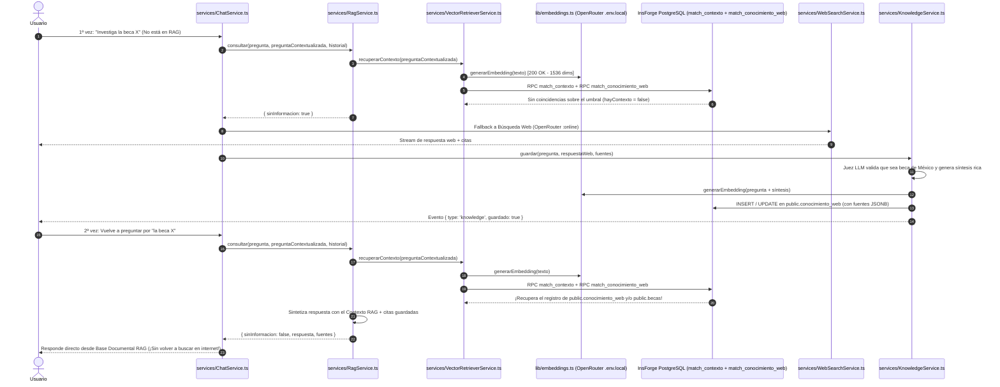

# Especificación Técnica: Corrección Definitiva del Ciclo RAG ↔ Búsqueda Web y Autoaprendizaje (SRP)

> **Estado:** Especificación lista para implementación  
> **Alcance:** Generador de Embeddings (`lib/embeddings.ts`), Recuperador Vectorial (`services/VectorRetrieverService.ts`), Servicio RAG (`services/RagService.ts`), Servicio de Autoaprendizaje (`services/KnowledgeService.ts`) y Orquestador (`services/ChatService.ts`).  
> **Principios rectores:** *Single Responsibility Principle (SRP)*, *Tolerancia a Fallos* y *Trazabilidad End-to-End*.

---

## 1. Diagnóstico Exacto: ¿Por Qué Siempre Buscaba en Internet y No Recuperaba del RAG?

Al realizar pruebas directas contra el backend de InsForge (`https://pm3ezvsp.us-east.insforge.app`), se identificaron **3 causas técnicas exactas**:

### Causa 1 (Principal): Secreto `OPENROUTER_API_KEY` expirado dentro del contenedor remoto de Edge Functions
- Cuando `RagService.ts` llamaba a `POST https://pm3ezvsp.us-east.insforge.app/functions/ask`, la Edge Function remota intentaba generar el embedding de la pregunta usando una clave antigua almacenada en los secretos internos del contenedor Deno y devolvía:
  ```json
  HTTP 502 Bad Gateway
  {
    "error": "Error generando embedding: OpenRouter /embeddings -> 401: {\"error\":{\"message\":\"API key expired.\",\"code\":401}}"
  }
  ```
- Como `/functions/ask` respondía `502`, `ChatService.ts` capturaba la excepción en el bloque `catch` y **saltaba siempre al fallback de Búsqueda Web (`WebSearchService.ts`)**, el cual sí funcionaba porque corría en el servidor de Next.js usando la clave vigente de `.env.local` (`OPENROUTER_API_KEY`).
- Exactamente lo mismo ocurría al finalizar la búsqueda web: cuando `KnowledgeService.ts` llamaba a `POST /functions/guardar-conocimiento`, dicha Edge Function remota también fallaba con `502 (401 API key expired)` al intentar generar el embedding para guardar el conocimiento en `public.conocimiento_web`.

### Causa 2: Firma de parámetros en las funciones RPC remotas (`match_contexto` y `match_conocimiento_web`)
- En la base de datos PostgreSQL remota de InsForge:
  - `public.match_contexto(query_embedding, match_count, filtro_grado)` recibe **3 parámetros** (no incluye `min_score` en la firma SQL).
  - `public.match_conocimiento_web(query_embedding, match_count)` recibe **2 parámetros** (no incluye `min_score` en la firma SQL).
- Si se invoca cualquiera de las dos funciones pasando `min_score` como argumento del RPC, PostgREST devuelve `PGRST202 (404 Function not found)`. El filtrado por umbral de similitud (`score >= minScore`) debe aplicarse en TypeScript sobre las filas devueltas.

### Causa 3: Actualización de Conocimiento Existente y Preservación de URLs en Citas
- Cuando una consulta web aprende información nueva sobre una beca (o actualiza datos de una beca como *Benito Juárez*), si ya existía un registro muy similar en `public.conocimiento_web` (`score >= 0.90`), el sistema debe **actualizar** el registro existente con la síntesis más completa (o insertarlo si es nuevo), y al recuperarlo en futuras preguntas debe devolver también las `fuentes` (`title` y `url`) almacenadas en `conocimiento_web.fuentes`.

---

## 2. Arquitectura de la Solución bajo SRP (Single Responsibility Principle)

Para eliminar la dependencia del contenedor remoto con la clave expirada y garantizar que **tanto la lectura del RAG como el guardado de nuevo conocimiento web utilicen las credenciales vigentes de `.env.local` (`OPENROUTER_API_KEY` + `INSFORGE_API_KEY`)**, toda la tubería RAG se ejecuta en servicios modulares del servidor de Next.js:



---

## 3. Archivos Involucrados y Responsabilidad Única (SRP)

| Archivo | Responsabilidad Única (SRP) |
|---|---|
| **[`lib/embeddings.ts`](file:///home/josue-dev/university-projects/beca-bot/lib/embeddings.ts)** *(Nuevo)* | Generar vectores de 1536 dimensiones llamando a `https://openrouter.ai/api/v1/embeddings` (`openai/text-embedding-3-small`) con la clave vigente `process.env.OPENROUTER_API_KEY`. |
| **[`services/VectorRetrieverService.ts`](file:///home/josue-dev/university-projects/beca-bot/services/VectorRetrieverService.ts)** *(Nuevo)* | Ejecutar la búsqueda vectorial en PostgreSQL mediante `insforgeAdmin`:<br>1. `rpc('match_contexto', { query_embedding, match_count: 6, filtro_grado })` y filtrar `score >= 0.38`.<br>2. Enriquecer con los `requisitos` hermanos de las becas encontradas.<br>3. `rpc('match_conocimiento_web', { query_embedding, match_count: 4 })` y filtrar `score >= 0.45`.<br>4. Construir el bloque `contextoTexto` y la lista de `fuentes` (incluyendo las URLs guardadas en `conocimiento_web`). |
| **[`services/RagService.ts`](file:///home/josue-dev/university-projects/beca-bot/services/RagService.ts)** *(Actualización)* | Orquestar la respuesta RAG en el servidor:<br>1. Pedir el contexto a `vectorRetrieverService.recuperarContexto(...)`.<br>2. Si `hayContexto === false`, devolver inmediatamente `{ sinInformacion: true }` para activar la búsqueda web.<br>3. Si `hayContexto === true`, invocar el modelo LLM con `SYSTEM_BECA_BOT_RAG` y el `Contexto` recuperado.<br>4. Evaluar `esRespuestaSinInformacion(respuesta)` y devolver `{ respuesta, fuentes, sinInformacion }`. |
| **[`services/KnowledgeService.ts`](file:///home/josue-dev/university-projects/beca-bot/services/KnowledgeService.ts)** *(Actualización)* | Evaluar y persistir en `public.conocimiento_web` lo aprendido en internet:<br>1. Ejecutar el Juez LLM (verificando que sea información útil sobre becas en México y generando un resumen detallado con requisitos, montos y fechas).<br>2. Generar el embedding con `lib/embeddings.ts`.<br>3. Verificar en `match_conocimiento_web` si ya existe un registro casi idéntico (`score >= 0.92`): si existe, actualizarlo con la información más reciente; si no existe, insertarlo en `public.conocimiento_web`. |
| **[`services/ChatService.ts`](file:///home/josue-dev/university-projects/beca-bot/services/ChatService.ts)** *(Actualización)* | Preservar tanto el `title` como el `url` de las fuentes devueltas por `ragService.consultar(...)` al emitir el evento `{ type: 'citations', items }` para que las respuestas del RAG muestren también los enlaces aprendidos. |

---

## 4. Criterios de Verificación

1. **Recuperación inmediata de becas existentes (ej. Beca Benito Juárez):**
   - Al preguntar *"¿Qué requisitos pide la Beca Benito Juárez?"* o *"Investiga la Beca Benito Juárez"*, `VectorRetrieverService` encuentra la beca en `public.becas` (`score ~ 0.67`) y en `public.conocimiento_web` (`score ~ 0.82`) y responde con la etiqueta **`Base Documental RAG`** sin ir a buscar a internet.
2. **Ciclo completo de Autoaprendizaje (Pregunta nueva → Web → Guardado en RAG → Segunda pregunta desde RAG):**
   - Si se pregunta por una beca o convocatoria de México que aún no esté en la base de datos:
     - En la **1ª consulta**, el RAG detecta que no tiene contexto, busca en la web (`Búsqueda Web Oficial`), responde y muestra *"Conocimiento verificado aprendido y guardado en la Base RAG de México"*.
     - En la **2ª consulta** sobre esa misma beca, `VectorRetrieverService` recupera el conocimiento recién insertado en `public.conocimiento_web` y responde desde **`Base Documental RAG`** sin volver a buscar en internet.
3. **Compilación limpia:**
   - `pnpm run build` finaliza con código `0`.
