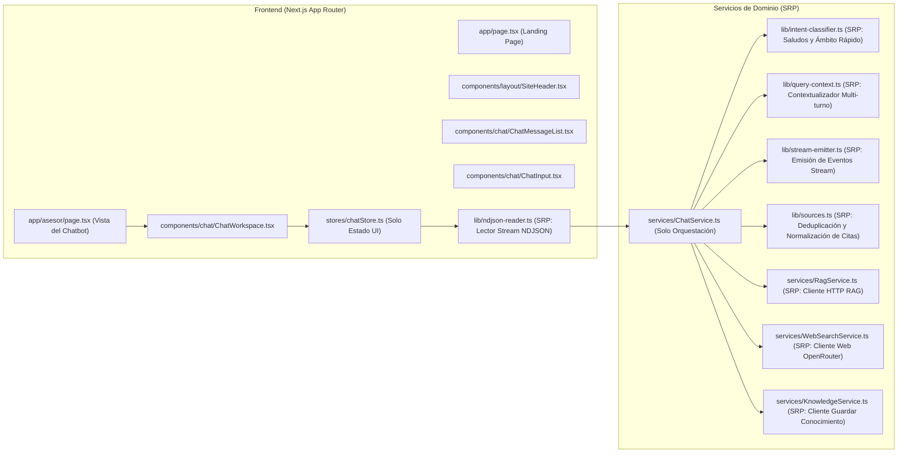

# Especificación Técnica: Auditoría de Código, Refactorización SRP y Buenas Prácticas en React / Next.js

> **Estado:** Especificación aprobada para implementación  
> **Alcance:** Servicios (`services/`), Utilidades (`lib/`), Estado (`stores/`), Componentes y Rutas de Next.js (`app/`), y Edge Functions (`insforge/functions/`).  
> **Principios rectores:** *Single Responsibility Principle (SRP)* y *React 19 / Next.js 16 Best Practices*.

---

## 1. Hallazgos de la Verificación del Código Existente

Al auditar el código actual del repositorio se detectaron los siguientes defectos técnicos y violaciones al principio de responsabilidad única (SRP):

### 1.1 Errores Técnicos y Bugs Directos
1. **`useSearchParams()` sin `<Suspense>` en [`app/verify-email/page.tsx`](file:///home/josue-dev/university-projects/beca-bot/app/verify-email/page.tsx#L24):**
   - En Next.js 16 (`next: 16.3.5`), invocar `useSearchParams()` en un Client Component de nivel de página sin envolverlo en un límite `<Suspense>` provoca un fallo de compilación durante el prerenderizado estático (`Missing Suspense boundary with useSearchParams`).
2. **Bloqueo global de scroll en [`app/layout.tsx`](file:///home/josue-dev/university-projects/beca-bot/app/layout.tsx#L11):**
   - `<body className="flex h-dvh flex-col overflow-hidden">` bloquea el scroll del documento entero asumiendo que toda la aplicación es únicamente la ventana del chat. Esto rompe el comportamiento natural de una Landing Page, del footer y de páginas informativas.
3. **Colisión de dimensiones en [`app/components/SiteHeader.tsx`](file:///home/josue-dev/university-projects/beca-bot/app/components/SiteHeader.tsx#L21):**
   - El contenedor del header tiene `py-10 h-14` (`padding-top: 2.5rem; padding-bottom: 2.5rem` = `80px` totales contra `height: 3.5rem` = `56px`). Esto desborda la altura real del header fijo y hace que se superponga sobre el contenido de las vistas que solo compensan `pt-14`.
   - Además, los enlaces apuntan a `/comming-soon` (typo con doble `m`).
4. **Código muerto en [`services/AIService.ts`](file:///home/josue-dev/university-projects/beca-bot/services/AIService.ts):**
   - No es importado por ningún archivo del proyecto; utiliza un modelo genérico (`openrouter/free`) y duplica la intención de `ChatService.ts` y `WebSearchService.ts`.
5. **Conversaciones y mensajes huérfanos en [`insforge/functions/ask.ts`](file:///home/josue-dev/university-projects/beca-bot/insforge/functions/ask.ts#L63-L143):**
   - El código de `ask.ts` intenta leer el usuario autenticado y persistir en `conversaciones` y `mensajes`, pero [`services/RagService.ts`](file:///home/josue-dev/university-projects/beca-bot/services/RagService.ts#L24-L32) jamás reenvía el token de autorización ni el historial conversacional.

---

### 1.2 Violaciones al Principio de Responsabilidad Única (SRP)

| Archivo actual | Responsabilidades mezcladas (Violación SRP) |
|---|---|
| [`services/ChatService.ts`](file:///home/josue-dev/university-projects/beca-bot/services/ChatService.ts) | 1) Orquestación del flujo (RAG → Web → Knowledge), 2) Formateo y simulación de streaming por lotes (`emitirTextoRag`), 3) Consumo del stream del AI SDK (`emitirRespuestaWeb`), 4) Deduplicación de fuentes (`dedupeFuentes`). |
| [`app/components/Welcome.tsx`](file:///home/josue-dev/university-projects/beca-bot/app/components/Welcome.tsx) | 1) Pantalla vacía de bienvenida del asesor, 2) Contenedor con scroll de mensajes activos, 3) Renderizado de burbujas de usuario y artículos de respuesta con citas, 4) Barra superior de reinicio de sesión y sugerencias rápidas. |
| [`app/login/page.tsx`](file:///home/josue-dev/university-projects/beca-bot/app/login/page.tsx), [`app/signup/page.tsx`](file:///home/josue-dev/university-projects/beca-bot/app/signup/page.tsx), [`app/verify-email/page.tsx`](file:///home/josue-dev/university-projects/beca-bot/app/verify-email/page.tsx) | 1) Reglas de validación (`EMAIL_RE`, longitud de contraseña, formato de username), 2) Llamadas directas a `insforge.auth` e `insforge.database`, 3) Manejo de `sessionStorage`, 4) Componentes visuales de inputs, OTP y alertas de formulario. |
| [`insforge/functions/ask.ts`](file:///home/josue-dev/university-projects/beca-bot/insforge/functions/ask.ts) | 1) Controlador HTTP/CORS, 2) Búsqueda vectorial en `match_contexto` y `match_conocimiento_web`, 3) Construcción del prompt de contexto, 4) Persistencia de conversaciones/mensajes, 5) Filtrado de respuesta y citas. |
| [`stores/chatStore.ts`](file:///home/josue-dev/university-projects/beca-bot/stores/chatStore.ts) | 1) Estado reactivo de la UI (`messages`, `prompt`, `isGenerating`), 2) Cliente HTTP `fetch("/api/chat")`, 3) Parser manual de chunks `ReadableStream` NDJSON. |

---

## 2. Arquitectura Modular Propuesta (Cumplimiento Estricto de SRP)

Cada archivo y módulo tendrá **una única responsabilidad** claramente delimitada:

---

### 2.1 Capa de Utilidades y Dominio (`lib/`)

1. **`lib/chat-stream.ts`**
   - **Responsabilidad única:** Definir los tipos del contrato de eventos (`ChatEvent`, `ChatMessage`, `ChatFuente`, `OrigenRespuesta`), la constante `SIN_INFORMACION` y la serialización `encodeEvent`.
2. **`lib/text-normalizer.ts`** *(Nuevo)*
   - **Responsabilidad única:** Normalizar texto en español (quitar acentos, pasar a minúsculas, limpiar puntuación) y evaluar de forma robusta `esRespuestaSinInformacion(texto)`.
3. **`lib/intent-classifier.ts`** *(Nuevo)*
   - **Responsabilidad única:** Detectar intenciones inmediatas (saludos, `"¿quién eres?"`, `"¿qué haces?"`, `"¿cómo funcionas?"`) y devolver la respuesta rápida correspondiente sin gastar llamadas a embeddings ni búsqueda web.
4. **`lib/query-context.ts`** *(Nuevo)*
   - **Responsabilidad única:** Construir la consulta enriquecida con el contexto de los últimos mensajes de la conversación (`construirPreguntaContextualizada(messages)`) para que el RAG entienda preguntas de seguimiento como *"¿Y cuáles son sus requisitos?"*.
5. **`lib/sources.ts`** *(Nuevo)*
   - **Responsabilidad única:** Filtrar, normalizar y deduplicar citas (`dedupeFuentes`) tanto del RAG como de la búsqueda web.
6. **`lib/stream-emitter.ts`** *(Nuevo)*
   - **Responsabilidad única:** Emitir texto progresivo (`emitirTextoEnLotes`) y transformar el `fullStream` del AI SDK en eventos `ChatEvent` (`consumirStreamWeb`).
7. **`lib/ndjson-reader.ts`** *(Nuevo)*
   - **Responsabilidad única:** Leer un `ReadableStream<Uint8Array>` en el navegador, separar líneas `\n` con buffer seguro y emitir objetos `ChatEvent` ya parseados al callback consumidor.
8. **`lib/validators.ts`** *(Nuevo)*
   - **Responsabilidad única:** Funciones puras de validación de formularios (`validarEmail`, `validarUsername`, `validarPassword`, `validarCodigoOtp`) reutilizadas en Login, Signup y Verify Email.

---

### 2.2 Capa de Servicios (`services/`)

1. **`services/ChatService.ts`**
   - **Responsabilidad única:** Orquestar el caso de uso de responder un turno de chat:
     1. Verificar intención rápida (`intent-classifier`).
     2. Contextualizar la consulta (`query-context`).
     3. Consultar `ragService.consultar(...)`.
     4. Si el RAG no tiene información suficiente, delegar a `webSearchService.responder(...)` y notificar a `knowledgeService.guardar(...)`.
2. **`services/RagService.ts`**
   - **Responsabilidad única:** Comunicarse por HTTP con `${INSFORGE_URL}/functions/ask` enviando `{ pregunta, pregunta_contextualizada, historial, grado_academico }` y transformar la respuesta JSON al tipo `ResultadoRag`.
3. **`services/WebSearchService.ts`**
   - **Responsabilidad única:** Configurar e invocar `streamText` con el proveedor OpenRouter + plugin `web` y el prompt `SYSTEM_BECA_BOT_WEB`.
4. **`services/KnowledgeService.ts`**
   - **Responsabilidad única:** Enviar de forma *best-effort* la respuesta web a `${INSFORGE_URL}/functions/guardar-conocimiento`.
5. **`services/AuthService.ts`** *(Nuevo)*
   - **Responsabilidad única:** Encapsular las operaciones de autenticación y creación de perfil con el SDK de InsForge (`iniciarSesion`, `registrarCuenta`, `verificarCorreoYCrearPerfil`, `reenviarCodigo`, `obtenerUsuarioActual`), eliminando llamadas directas a `insforge.database` y `sessionStorage` dentro de los componentes React.
6. **Eliminación de `services/AIService.ts`:** Se elimina por ser código muerto sin referencias.

---

### 2.3 Capa de Edge Functions en InsForge (`insforge/functions/`)

1. **`insforge/functions/_shared/rag-retriever.ts`** *(Nuevo)*
   - **Responsabilidad única:** Ejecutar la recuperación semántica en PostgreSQL (`match_contexto` + enriquecimiento de requisitos hermanos de las becas encontradas + `match_conocimiento_web`) y formatear el bloque `Contexto` incluyendo `grado_academico`, `fecha_expiracion` y estado de vigencia.
2. **`insforge/functions/_shared/text.ts`**
   - **Responsabilidad única:** Utilidades de texto para Deno (`approxTokens`, `chunkText`, `tituloDesdePregunta`, `esRespuestaSinInformacion`).
3. **`insforge/functions/ask.ts`**
   - **Responsabilidad única:** Controlador HTTP de la función `ask` que valida la entrada, delega la recuperación a `rag-retriever.ts`, invoca `chat()` con las reglas estrictas de México y devuelve `{ respuesta, fuentes, sin_informacion, id_conversacion }`.
4. **`insforge/functions/guardar-conocimiento.ts`**
   - **Responsabilidad única:** Evaluar mediante el juez LLM si una respuesta web aporta datos concretos sobre **becas en México**, verificar duplicados (`>= 0.92`) e insertar en `public.conocimiento_web`.

---

### 2.4 Capa de Componentes React (`app/components/`) y Buenas Prácticas React 19

Siguiendo las mejores prácticas de **React 19 y Next.js 16**:
- **Server Components por defecto:** La Landing Page (`app/page.tsx`), la página de Planes (`app/premium/page.tsx`) y los componentes estáticos e iconos SVG son **Server Components** puros (0 KB de JS innecesario en el cliente).
- **`'use client'` solo en las hojas interactivas:** Únicamente los componentes que usan estado, eventos de usuario o Zustand (`ChatWorkspace`, `ChatInput`, formularios de Auth, `SiteHeader` para `usePathname`) llevan la directiva `'use client'`.
- **Descomposición del Chatbot (antes monolítico en `Welcome.tsx`):**
  1. `app/components/chat/ChatWorkspace.tsx`: Contenedor principal del asesor que alterna entre el estado inicial (`ChatEmptyState`) y la sesión activa (`ChatMessageList` + `ChatInput`).
  2. `app/components/chat/ChatEmptyState.tsx`: Vista inicial del chatbot con las preguntas frecuentes y disparadores rápidos.
  3. `app/components/chat/ChatMessageList.tsx`: Lista con scroll automático de los turnos de conversación y barra de reinicio de consulta.
  4. `app/components/chat/ChatMessageItem.tsx`: Renderiza un mensaje individual (burbuja de usuario o artículo del asistente con `SourceBadge`, `AIResponse` y lista de citas).
- **Corrección de `<Suspense>` en `app/verify-email/page.tsx`:**
  - Separar el formulario interactivo que lee `useSearchParams()` en un subcomponente envuelto en `<Suspense fallback={...}>` dentro de `VerifyEmailPage`.
- **Selectores atómicos en Zustand (`stores/chatStore.ts`):**
  - Mantener selectores granulares `useAIStore((s) => s.messages)` y delegar la lectura del stream a `lib/ndjson-reader.ts`.

---

## 3. Checklist de Verificación de Calidad

- [ ] Ningún archivo mezcla lógica de transporte HTTP, reglas de base de datos y renderizado de interfaz.
- [ ] `pnpm run lint` y `pnpm run build` (Next.js 16 production build) finalizan con **0 errores y 0 advertencias**.
- [ ] `node insforge/build.mjs` empaqueta limpiamente los 4 bundles en `insforge/dist/`.
- [ ] `app/verify-email/page.tsx` compila estáticamente gracias al límite `<Suspense>`.
