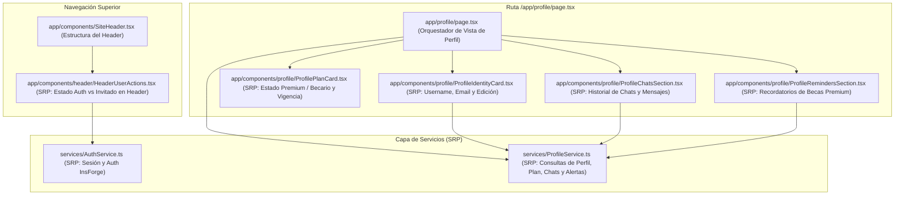

# Especificación Técnica y de Diseño: Perfil de Usuario (`/profile`), Header Autenticado y Recordatorios Premium

> **Estado:** Especificación lista para implementación  
> **Alcance:** Ruta `/app/profile/page.tsx`, Header con estado de sesión (`SiteHeader.tsx`), Servicio de Perfil (`services/ProfileService.ts`), Servicio de Autenticación (`services/AuthService.ts`) y Componentes Modulares de Perfil (`app/components/profile/`).  
> **Principios rectores:** *Single Responsibility Principle (SRP)*, *React 19 / Next.js 16 Best Practices* y **Estética Estricta Blanco y Negro de Alto Contraste (`border-2 border-black`, `shadow-[4px_4px_0px_#000000]`)**.

---

## 1. Objetivo del Módulo de Perfil

Construir la experiencia completa del **Perfil de Usuario en `/profile`** y adaptar el **Header superior** para usuarios con sesión activa, cumpliendo con los siguientes requerimientos:

1. **Header Exclusivo para Sesión Activa:**
   - Conserva la identidad tipográfica (`BecaBot MÉXICO · Orientación Oficial` sin ícono), la navegación central (`Inicio`, `Asesor IA`, `Planes`) y el CTA contextual (`Preguntar al Asesor` / `Planes Premium`).
   - **Oculta** los enlaces de `"Iniciar sesión"` / `"Crear cuenta"` cuando el usuario está autenticado (o dentro de `/profile`).
   - En su lugar, muestra el acceso directo a **`Perfil` (`/profile`)** con el `@username` (o correo), insignia de nivel (`PRO` si es Premium) y opción de cerrar sesión.
2. **Página `/profile` (`/app/profile/page.tsx`):**
   - **Información de la cuenta:** `username`, `email`, fecha de registro (`created_at`) y edición rápida de `username`.
   - **Información del Plan:** Muestra claramente si el usuario cuenta con **Plan Premium Activo** (vigencia `fecha_fin`, estado de suscripción en `public.suscripciones` y función RPC `public.es_premium`) o **Plan Becario (Gratuito)** con acceso para mejorar su plan en `/premium`.
   - **Historial de Chats y Mensajes (`public.conversaciones` y `public.mensajes`):**
     - Métricas de actividad: total de conversaciones creadas y total de mensajes enviados/recibidos.
     - Listado interactivo de los chats del usuario con fecha, conteo de mensajes y previsualización de los mensajes de cada conversación (con opción de eliminar conversación o continuar en `/asesor`).
   - **Recordatorios de Becas (Exclusivo Premium — `public.alertas_beca` y `public.postulaciones`):**
     - **Si el usuario es Premium:** Muestra sus recordatorios activos de becas (nombre de la beca, grado académico, fecha límite `fecha_expiracion`, días de aviso antes del cierre `[30, 7, 1]`, canal `email`, estado de postulación y botón para activar/pausar alerta).
     - **Si el usuario NO es Premium:** Muestra una tarjeta bloqueada de alto contraste explicando cómo funcionan los recordatorios automáticos de convocatorias con un CTA hacia `/premium`.

---

## 2. Arquitectura Modular bajo el Principio de Responsabilidad Única (SRP)

Cada archivo tiene **una única razón para cambiar**:



### 2.1 Desglose de Responsabilidades por Archivo

| Archivo | Responsabilidad Única (SRP) |
|---|---|
| `services/AuthService.ts` | Gestionar la sesión de autenticación con InsForge (`iniciarSesion`, `registrarCuenta`, `verificarCorreo`, `obtenerUsuarioActual`, `cerrarSesion`). |
| `services/ProfileService.ts` | Consultar y actualizar en PostgreSQL (vía InsForge SDK con RLS del usuario) los datos agregados del perfil: fila en `usuarios`, verificación `es_premium` + `suscripciones`, lista de `conversaciones` con sus `mensajes`, y `alertas_beca` / `postulaciones` vinculadas a `becas`. |
| `app/components/header/HeaderUserActions.tsx` | Detectar si existe sesión activa y renderizar: si **no** hay sesión → `"Iniciar sesión"`; si **sí** hay sesión → botón `"Mi Perfil (@username)"` hacia `/profile` con badge de plan. |
| `app/components/SiteHeader.tsx` | Renderizar la barra superior fija (`h-20`, `border-b-2 border-black bg-white`) integrando la marca tipográfica, los enlaces de navegación y `HeaderUserActions`. |
| `app/components/profile/ProfileIdentityCard.tsx` | Mostrar y permitir editar el `username`, visualizar el `email` verificado, la fecha de alta y el botón de `Cerrar sesión`. |
| `app/components/profile/ProfilePlanCard.tsx` | Mostrar el detalle del plan actual (`PLAN PREMIUM ACTIVO` vs `PLAN BECARIO GRATUITO`), métricas de uso, fecha de renovación/vencimiento y CTA contextual. |
| `app/components/profile/ProfileChatsSection.tsx` | Listar las `conversaciones` del usuario, mostrar el conteo total de chats y `mensajes`, permitir expandir los mensajes (`user` / `assistant`) de cada chat o eliminarlos. |
| `app/components/profile/ProfileRemindersSection.tsx` | Si `isPremium === true`, listar y gestionar los recordatorios de becas (`alertas_beca` + `postulaciones` + `becas.fecha_expiracion`); si `isPremium === false`, presentar el estado bloqueado con vista previa del beneficio Premium. |
| `app/profile/page.tsx` | Página contenedora que coordina la carga del perfil del usuario autenticado (o redirige a `/login` si no hay sesión) y distribuye los datos a las 4 tarjetas modulares. |

---

## 3. Modelo de Datos y Consultas en InsForge (`services/ProfileService.ts`)

El esquema actual en [`migrations/20261013214445_becabot-schema.sql`](file:///home/josue-dev/university-projects/beca-bot/migrations/20261013214445_becabot-schema.sql) ya define las tablas y políticas RLS necesarias:

1. **Identidad (`public.usuarios`):**
   - Campos: `id_usuario`, `username`, `email`, `created_at`.
   - RLS: `usuarios_propio_select`, `usuarios_propio_insert`, `usuarios_propio_update`.
   - *Autosanación:* Si un usuario autenticado aún no tiene fila en `public.usuarios` (por ejemplo, si cerró la pestaña antes de completar el paso post-OTP), `ProfileService` crea o sincroniza automáticamente el registro con su `email` y el prefijo del correo como `username` inicial.
2. **Estado del Plan (`public.es_premium(uid)` y `public.suscripciones`):**
   - Se consulta `insforge.database.rpc('es_premium', { uid })` junto con la última fila de `public.suscripciones` (`estado`, `fecha_inicio`, `fecha_fin`, `precio_aplicado`, `moneda`).
3. **Chats y Mensajes (`public.conversaciones` y `public.mensajes`):**
   - Consulta de `public.conversaciones` ordenada por `fecha DESC`.
   - Consulta de `public.mensajes` asociados a las conversaciones del usuario (`id_mensaje`, `id_conversacion`, `mensaje`, `tipo`, `created_at`) para calcular el **total de mensajes** y permitir previsualizar el hilo completo desde `/profile`.
   - Además, sincroniza con el estado local de `useAIStore` en caso de que el usuario tenga mensajes en su sesión activa en el navegador.
4. **Recordatorios de Becas Exclusivos Premium (`public.alertas_beca` + `public.postulaciones` + `public.becas`):**
   - Cuando `isPremium === true`, se consultan:
     - `public.alertas_beca`: `id_alerta`, `id_beca`, `dias_antes` (`[30, 7, 1]`), `canal` (`email`), `activa`, `created_at`, haciendo join con `public.becas (id_beca, name, grado_academico, fecha_expiracion)`.
     - `public.postulaciones`: `id_postulacion`, `id_beca`, `estado` (`pendiente`, `enviada`, `aceptada`, `rechazada`), `notas`, `fecha_postulacion`.

---

## 4. Sistema Visual y Estética de `/profile` y del Header

Todo el módulo respeta estrictamente el lenguaje visual **Blanco y Negro de Alto Contraste** de la Landing Page y del Chatbot:

- **Superficies y Contenedores:**
  - Fondo de tarjeta: `bg-white` con borde `border-2 border-black` y sombra sólida `shadow-[6px_6px_0px_#000000]` (o `shadow-[4px_4px_0px_#000000]` en subtarjetas).
  - Fondos secundarios para bloques internos: `bg-neutral-50` o `bg-neutral-100` con `border-2 border-black`.
- **Tipografía y Contraste:**
  - Títulos: `font-display font-black tracking-tight text-black`.
  - Etiquetas superiores (tags): `border-2 border-black bg-black text-white text-[10px] font-black uppercase tracking-wider`.
  - Prohibido usar texto blanco sobre fondo blanco o grises tenues ilegibles; todo texto secundario usa `text-neutral-700` / `text-neutral-800` con `font-semibold` o `font-bold`.
- **Header (`SiteHeader.tsx` + `HeaderUserActions.tsx`):**
  - Sin ícono de mascota.
  - Cuando el usuario tiene sesión activa:
    - Desaparece el texto `"Iniciar sesión"`.
    - Aparece el botón **`Mi Perfil`** (`/profile`) con borde `border-2 border-black`, indicador verde en vivo (`bg-emerald-500`), nombre de usuario (`@username`) y badge `PRO` si es Premium.
    - Si el usuario se encuentra en `/profile`, el botón de `Mi Perfil` se muestra activo en negro sólido (`bg-black text-white shadow-[2px_2px_0px_rgba(0,0,0,0.3)]`).

---

## 5. Diseño de la Pantalla `/profile` (Layout de 2 Columnas + Secciones)

```
+-----------------------------------------------------------------------------------+
| HEADER: BecaBot MÉXICO  |  Inicio   Asesor IA   Planes  |  [● @usuario · Perfil]  |
+-----------------------------------------------------------------------------------+
| [BECABOT · PERFIL DE ESTUDIANTE]                                                  |
| Mi Cuenta y Expediente de Becas                               [Cerrar sesión ↗]   |
+-----------------------------------+-----------------------------------------------+
| 1. TARJETA DE IDENTIDAD           | 2. TARJETA DE PLAN Y MÉTRICAS                 |
| - @username (editable in-place)   | - Badge: PLAN PREMIUM / PLAN BECARIO          |
| - email verificado                | - Contadores: [N Chats] [M Mensajes] [Plan]   |
| - Miembro desde: Fecha            | - Vigencia / Botón "Mejorar a Premium →"      |
+-----------------------------------+-----------------------------------------------+
| 3. RECORDATORIOS DE BECAS (EXCLUSIVO PREMIUM)                                     |
| - Si es Premium: Lista de alertas activas (Beca, Grado, Cierre, Avisos 30/7/1 d)  |
|   + Selector rápido para agregar recordatorio de una beca de la base RAG.         |
| - Si es Becario (Gratis): Boceto enmarcado con candado tipográfico explicando     |
|   las alertas de cierre por correo (30, 7 y 1 día antes) + CTA a /premium.        |
+-----------------------------------------------------------------------------------+
| 4. HISTORIAL DE CHATS Y MENSAJES                                                  |
| - Lista de conversaciones guardadas + sesión actual en memoria                    |
| - Al seleccionar un chat, despliega sus mensajes (Tú / BecaBot Asesor)            |
| - Botón "+ Nueva consulta en el Asesor →"                                         |
+-----------------------------------------------------------------------------------+
```

---

## 6. Criterios de Aceptación

1. **Header reactivo a la sesión:** Si el usuario inició sesión, nunca ve `"Iniciar sesión"` ni `"Crear cuenta"` en el header; en su lugar ve el acceso directo a `/profile`.
2. **Ruta `/profile` funcional y protegida:** Muestra `username`, `email`, estado real de `es_premium`, métricas de `chats` y `mensajes`, listado de conversaciones/mensajes y sección de recordatorios de becas diferenciada entre usuarios Premium y gratuitos.
3. **Cumplimiento SRP:** Separación limpia entre `ProfileService.ts`, `HeaderUserActions.tsx` y los 4 subcomponentes de `app/components/profile/`.
4. **Compilación limpia:** `pnpm run build` en Next.js 16 finaliza con código `0`.
